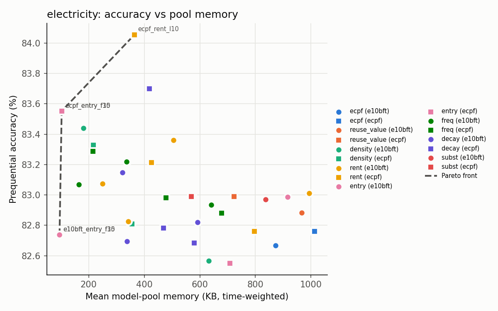
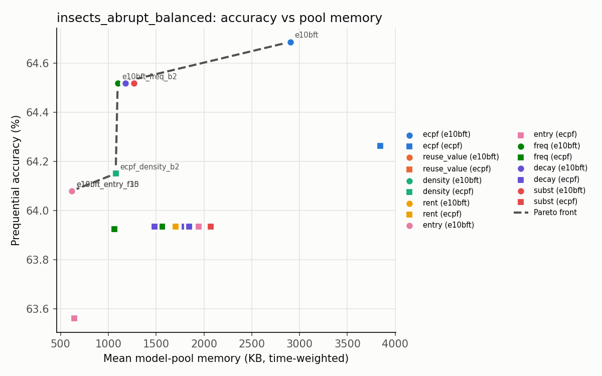
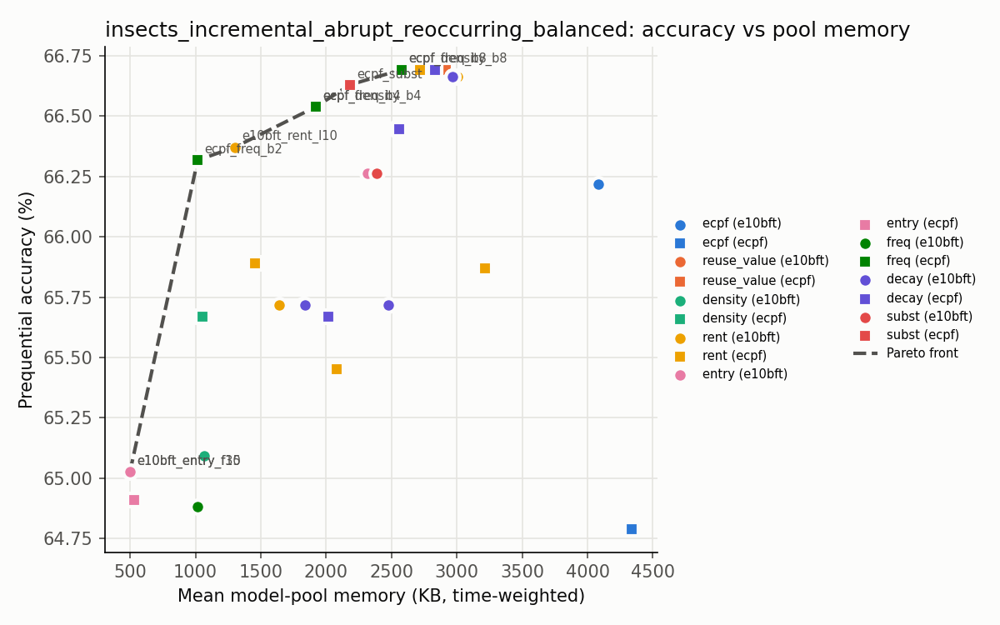
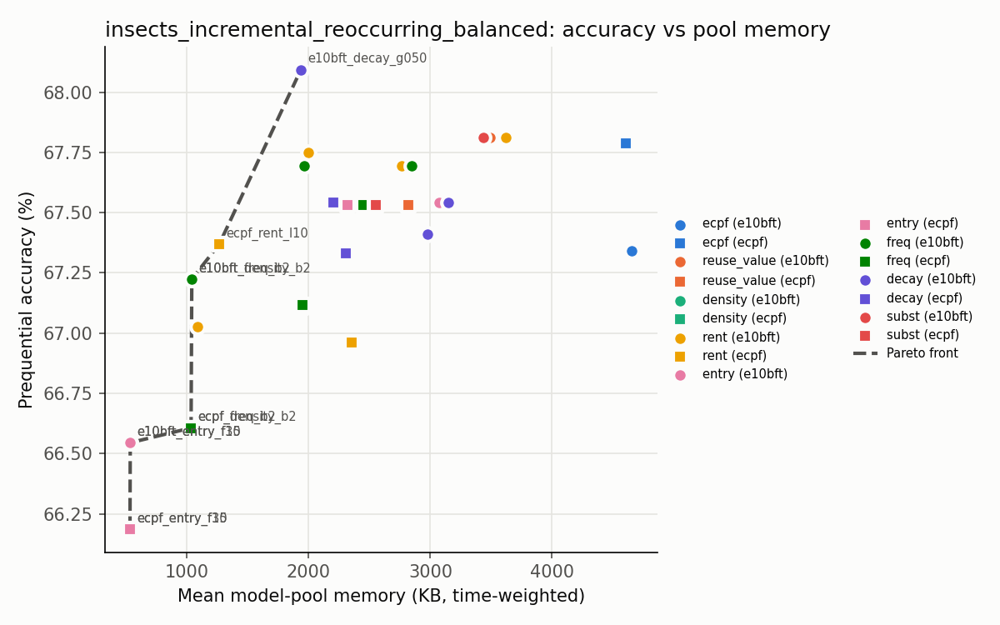
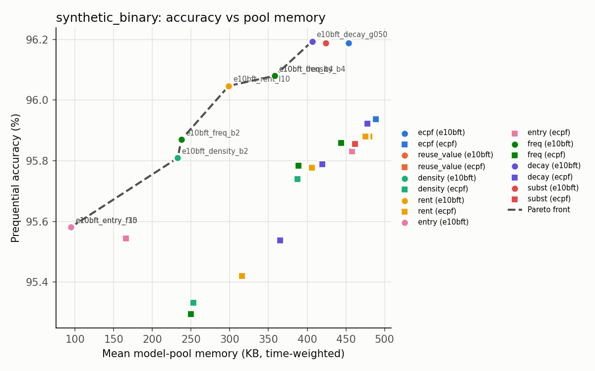

# Pool fade mechanisms — accuracy vs pool memory

Source: `outputs/benchmark_poolfade`; benchmark metrics from `runs.csv`, pool diagnostics from `pool_metrics.json`. Multi-stream datasets are averaged over their streams (`pool_runs.csv` has one row per run).

**Not comparable to literature:** synthetic_binary (registry `comparable: false` or non-comparable runs); use them only against the presets re-run here.

**Warning:** rows mix different `concurrent_runs`; times are indicative only.

## electricity

Streams: 1

Pareto-optimal (accuracy up, pool KB down): e10bft_entry_f15, e10bft_entry_f30, ecpf_entry_f15, ecpf_entry_f30, ecpf_rent_l10

| preset | acc | kappa_m | pool KB mean | pool KB peak | slots | recovery acc | regret rate | evictions (fade/cap/budget/merge) | reuse value mean | Δacc pts vs reuse_value | acc pts per 100 KB saved | pool time s | runtime s |
|---|---|---|---|---|---|---|---|---|---|---|---|---|---|
| e10bft_decay_g050 | 0.8315 | 0.6030 | 321.8 | 942.0 | 2.72 | 0.8318 | 0.230 | 45/0/0/89 | -2.16 | 0.26 | 0.041 | 6.80 | 24.1 |
| e10bft_decay_g080 | 0.8270 | 0.5923 | 337.2 | 1017.2 | 3.18 | 0.8269 | 0.207 | 31/0/0/112 | -4.93 | -0.19 | -0.030 | 6.88 | 25.4 |
| e10bft_decay_g095 | 0.8282 | 0.5953 | 591.4 | 1439.6 | 5.02 | 0.8197 | 0.180 | 25/0/0/121 | -6.76 | -0.06 | -0.016 | 8.18 | 25.9 |
| e10bft_density_b2 | 0.8344 | 0.6098 | 181.0 | 460.4 | 1.92 | 0.8298 | 0.363 | 7/0/76/64 | -4.73 | 0.56 | 0.071 | 6.81 | 24.9 |
| e10bft_density_b4 | 0.8322 | 0.6046 | 338.7 | 766.9 | 2.58 | 0.8283 | 0.286 | 3/0/50/86 | -6.39 | 0.34 | 0.053 | 7.54 | 25.8 |
| e10bft_density_b8 | 0.8257 | 0.5892 | 631.4 | 1439.6 | 4.27 | 0.8177 | 0.215 | 10/0/27/100 | -6.27 | -0.32 | -0.095 | 9.12 | 28.4 |
| e10bft | 0.8267 | 0.5916 | 873.1 | 1682.4 | 5.68 | 0.8167 | 0.101 | 10/0/0/124 | -6.04 | -0.22 | -0.232 | 9.17 | 27.4 |
| e10bft_entry_f15 | 0.8274 | 0.5933 | 94.9 | 244.2 | 1.00 | 0.8243 | 0.401 | 143/0/0/0 | 0.86 | -0.15 | -0.017 | 6.67 | 25.8 |
| e10bft_entry_f30 | 0.8274 | 0.5933 | 94.9 | 244.2 | 1.00 | 0.8243 | 0.401 | 143/0/0/0 | 0.86 | -0.15 | -0.017 | 6.88 | 26.3 |
| e10bft_entry_f5 | 0.8299 | 0.5992 | 915.2 | 1628.2 | 5.78 | 0.8198 | 0.136 | 17/0/0/122 | -6.04 | 0.10 | 0.203 | 9.43 | 27.4 |
| e10bft_freq_b2 | 0.8307 | 0.6011 | 164.6 | 460.4 | 1.93 | 0.8288 | 0.288 | 2/0/78/74 | -5.39 | 0.19 | 0.023 | 6.74 | 25.3 |
| e10bft_freq_b4 | 0.8322 | 0.6046 | 336.2 | 766.9 | 2.54 | 0.8283 | 0.286 | 3/0/50/86 | -6.39 | 0.34 | 0.053 | 7.81 | 27.3 |
| e10bft_freq_b8 | 0.8294 | 0.5980 | 641.1 | 1439.6 | 4.72 | 0.8210 | 0.155 | 10/0/17/120 | -4.16 | 0.05 | 0.016 | 8.98 | 27.1 |
| e10bft_rent_l1 | 0.8301 | 0.5998 | 993.4 | 1659.2 | 6.65 | 0.8225 | 0.095 | 11/2/0/117 | -4.83 | 0.13 |  | 9.09 | 26.6 |
| e10bft_rent_l10 | 0.8307 | 0.6012 | 248.9 | 766.9 | 2.39 | 0.8239 | 0.394 | 61/0/0/78 | -4.08 | 0.19 | 0.026 | 6.81 | 24.9 |
| e10bft_rent_l2 | 0.8336 | 0.6080 | 504.5 | 983.1 | 4.47 | 0.8326 | 0.133 | 19/0/0/130 | -4.43 | 0.48 | 0.103 | 8.35 | 26.5 |
| e10bft_rent_l5 | 0.8283 | 0.5954 | 342.4 | 766.9 | 3.09 | 0.8267 | 0.262 | 37/0/0/100 | -5.14 | -0.06 | -0.009 | 7.25 | 25.8 |
| e10bft_reuse_value | 0.8288 | 0.5967 | 966.3 | 1628.2 | 6.10 | 0.8181 | 0.135 | 15/0/0/122 | -5.49 | 0.00 |  | 9.71 | 27.6 |
| e10bft_subst | 0.8297 | 0.5988 | 837.4 | 1687.3 | 5.84 | 0.8208 | 0.101 | 18/0/0/116 | -7.44 | 0.09 | 0.067 | 12.38 | 33.3 |
| ecpf_decay_g050 | 0.8370 | 0.6160 | 417.8 | 1122.1 | 2.84 | 0.8355 | 0.197 | 26/0/0/47 | 0.33 | 0.71 | 0.232 | 5.37 | 19.0 |
| ecpf_decay_g080 | 0.8278 | 0.5943 | 468.6 | 1504.5 | 3.49 | 0.8237 | 0.224 | 25/0/0/51 | -3.44 | -0.21 | -0.081 | 5.61 | 19.2 |
| ecpf_decay_g095 | 0.8268 | 0.5921 | 580.4 | 1720.9 | 4.20 | 0.8236 | 0.134 | 14/0/0/65 | -8.95 | -0.30 | -0.213 | 5.40 | 17.9 |
| ecpf_density_b2 | 0.8333 | 0.6072 | 216.1 | 543.5 | 1.90 | 0.8250 | 0.273 | 9/0/39/32 | -4.88 | 0.34 | 0.067 | 5.05 | 18.8 |
| ecpf_density_b4 | 0.8281 | 0.5950 | 355.1 | 943.5 | 2.76 | 0.8233 | 0.232 | 11/0/22/40 | -7.89 | -0.18 | -0.049 | 5.02 | 18.3 |
| ecpf_density_b8 | 0.8288 | 0.5967 | 677.7 | 1720.9 | 4.54 | 0.8227 | 0.141 | 7/0/5/61 | -3.08 | -0.11 | -0.235 | 5.90 | 18.4 |
| ecpf_paper | 0.8276 | 0.5938 | 1012.8 | 1746.0 | 6.11 | 0.8264 | 0.034 | 12/0/0/61 | -14.08 | -0.23 |  | 6.45 | 19.5 |
| ecpf_entry_f15 | 0.8355 | 0.6125 | 102.6 | 302.2 | 1.00 | 0.8310 | 0.333 | 76/0/0/0 | -1.47 | 0.56 | 0.091 | 4.43 | 19.2 |
| ecpf_entry_f30 | 0.8355 | 0.6125 | 102.6 | 302.2 | 1.00 | 0.8310 | 0.333 | 76/0/0/0 | -1.47 | 0.56 | 0.091 | 4.47 | 19.3 |
| ecpf_entry_f5 | 0.8255 | 0.5889 | 708.0 | 1720.9 | 4.71 | 0.8209 | 0.156 | 17/0/0/57 | -11.68 | -0.44 | -2.801 | 5.92 | 18.8 |
| ecpf_freq_b2 | 0.8329 | 0.6062 | 214.8 | 543.5 | 1.86 | 0.8248 | 0.286 | 9/0/39/32 | -5.61 | 0.30 | 0.059 | 5.09 | 19.0 |
| ecpf_freq_b4 | 0.8298 | 0.5991 | 477.8 | 943.5 | 3.08 | 0.8241 | 0.227 | 4/0/16/60 | -4.76 | -0.01 | -0.003 | 5.75 | 18.4 |
| ecpf_freq_b8 | 0.8288 | 0.5967 | 677.7 | 1720.9 | 4.54 | 0.8227 | 0.141 | 7/0/5/61 | -3.08 | -0.11 | -0.235 | 5.85 | 18.4 |
| ecpf_rent_l1 | 0.8276 | 0.5938 | 796.4 | 1720.9 | 4.89 | 0.8241 | 0.109 | 11/0/0/63 | -9.71 | -0.23 |  | 6.45 | 19.3 |
| ecpf_rent_l10 | 0.8405 | 0.6243 | 364.9 | 838.0 | 2.40 | 0.8431 | 0.254 | 27/0/0/43 | -1.80 | 1.07 | 0.297 | 5.27 | 19.2 |
| ecpf_rent_l2 | 0.8299 | 0.5993 | 575.9 | 1504.5 | 3.84 | 0.8191 | 0.190 | 17/0/0/55 | -11.04 | 0.00 | 0.001 | 5.00 | 17.4 |
| ecpf_rent_l5 | 0.8321 | 0.6045 | 425.3 | 1246.9 | 3.09 | 0.8304 | 0.236 | 21/0/0/55 | -5.14 | 0.23 | 0.075 | 5.91 | 19.5 |
| ecpf_reuse_value | 0.8299 | 0.5992 | 723.6 | 1720.9 | 4.71 | 0.8279 | 0.129 | 12/0/0/61 | -8.12 | 0.00 |  | 5.94 | 18.4 |
| ecpf_subst | 0.8299 | 0.5992 | 569.5 | 1720.9 | 3.92 | 0.8226 | 0.209 | 11/0/0/66 | -11.33 | 0.00 | 0.000 | 6.72 | 20.9 |

## insects_abrupt_balanced

Streams: 1

Pareto-optimal (accuracy up, pool KB down): e10bft, e10bft_entry_f15, e10bft_entry_f30, e10bft_freq_b2, ecpf_density_b2

| preset | acc | kappa_m | pool KB mean | pool KB peak | slots | recovery acc | regret rate | evictions (fade/cap/budget/merge) | reuse value mean | Δacc pts vs reuse_value | acc pts per 100 KB saved | pool time s | runtime s |
|---|---|---|---|---|---|---|---|---|---|---|---|---|---|
| e10bft_decay_g050 | 0.6452 | 0.5713 | 1174.3 | 2686.5 | 1.62 | 0.6232 | 0.267 | 8/0/0/9 | -75.94 | 0.00 | 0.000 | 5.00 | 77.8 |
| e10bft_decay_g080 | 0.6452 | 0.5713 | 1180.7 | 2686.5 | 1.64 | 0.6232 | 0.267 | 7/0/0/9 | -75.94 | 0.00 | 0.000 | 5.07 | 77.6 |
| e10bft_decay_g095 | 0.6452 | 0.5713 | 1265.5 | 2686.5 | 1.76 | 0.6232 | 0.267 | 7/0/0/9 | -75.94 | 0.00 |  | 5.02 | 77.0 |
| e10bft_density_b2 | 0.6452 | 0.5713 | 1123.1 | 2686.5 | 1.64 | 0.6232 | 0.267 | 7/0/3/6 | -75.94 | 0.00 | 0.000 | 5.01 | 76.7 |
| e10bft_density_b4 | 0.6452 | 0.5713 | 1265.5 | 2686.5 | 1.76 | 0.6232 | 0.267 | 7/0/0/9 | -75.94 | 0.00 |  | 5.05 | 77.4 |
| e10bft_density_b8 | 0.6452 | 0.5713 | 1265.5 | 2686.5 | 1.76 | 0.6232 | 0.267 | 7/0/0/9 | -75.94 | 0.00 |  | 5.06 | 77.6 |
| e10bft | 0.6469 | 0.5733 | 2903.5 | 6498.8 | 3.96 | 0.6506 |  | 0/0/0/7 | -71.85 | 0.17 |  | 4.32 | 78.0 |
| e10bft_entry_f15 | 0.6408 | 0.5660 | 619.3 | 1343.3 | 1.00 | 0.6064 | 0.294 | 18/0/0/0 | -47.94 | -0.44 | -0.068 | 5.41 | 82.8 |
| e10bft_entry_f30 | 0.6408 | 0.5660 | 619.3 | 1343.3 | 1.00 | 0.6064 | 0.294 | 18/0/0/0 | -47.94 | -0.44 | -0.068 | 5.44 | 85.2 |
| e10bft_entry_f5 | 0.6452 | 0.5713 | 1174.3 | 2686.5 | 1.62 | 0.6232 | 0.267 | 8/0/0/9 | -75.94 | 0.00 | 0.000 | 5.06 | 77.8 |
| e10bft_freq_b2 | 0.6452 | 0.5713 | 1097.5 | 2686.5 | 1.60 | 0.6232 | 0.267 | 6/0/3/7 | -89.88 | 0.00 | 0.000 | 5.14 | 81.7 |
| e10bft_freq_b4 | 0.6452 | 0.5713 | 1265.5 | 2686.5 | 1.76 | 0.6232 | 0.267 | 7/0/0/9 | -75.94 | 0.00 |  | 5.11 | 78.6 |
| e10bft_freq_b8 | 0.6452 | 0.5713 | 1265.5 | 2686.5 | 1.76 | 0.6232 | 0.267 | 7/0/0/9 | -75.94 | 0.00 |  | 5.04 | 76.1 |
| e10bft_rent_l1 | 0.6452 | 0.5713 | 1265.5 | 2686.5 | 1.76 | 0.6232 | 0.267 | 7/0/0/9 | -75.94 | 0.00 |  | 5.04 | 77.0 |
| e10bft_rent_l10 | 0.6452 | 0.5713 | 1132.9 | 2686.5 | 1.57 | 0.6232 | 0.267 | 8/0/0/9 | -89.88 | 0.00 | 0.000 | 5.02 | 77.3 |
| e10bft_rent_l2 | 0.6452 | 0.5713 | 1180.7 | 2686.5 | 1.64 | 0.6232 | 0.267 | 7/0/0/9 | -75.94 | 0.00 | 0.000 | 5.02 | 77.6 |
| e10bft_rent_l5 | 0.6452 | 0.5713 | 1174.3 | 2686.5 | 1.62 | 0.6232 | 0.267 | 8/0/0/9 | -75.94 | 0.00 | 0.000 | 5.02 | 77.4 |
| e10bft_reuse_value | 0.6452 | 0.5713 | 1265.5 | 2686.5 | 1.76 | 0.6232 | 0.267 | 7/0/0/9 | -75.94 | 0.00 |  | 5.04 | 76.9 |
| e10bft_subst | 0.6452 | 0.5713 | 1265.5 | 2686.5 | 1.76 | 0.6232 | 0.267 | 7/0/0/9 | -75.94 | 0.00 |  | 5.53 | 79.5 |
| ecpf_decay_g050 | 0.6393 | 0.5642 | 1482.5 | 3362.3 | 2.12 | 0.6392 | 0.158 | 10/0/0/11 | -29.05 | 0.00 | 0.000 | 25.22 | 92.3 |
| ecpf_decay_g080 | 0.6393 | 0.5642 | 1799.9 | 3807.8 | 2.67 | 0.6392 | 0.158 | 9/0/0/12 | -29.05 | 0.00 | 0.000 | 27.04 | 91.0 |
| ecpf_decay_g095 | 0.6393 | 0.5642 | 1842.5 | 3807.8 | 2.73 | 0.6392 | 0.158 | 8/0/0/13 | -29.05 | 0.00 | 0.000 | 27.13 | 90.6 |
| ecpf_density_b2 | 0.6415 | 0.5668 | 1076.3 | 2685.8 | 1.74 | 0.6513 | 0.263 | 1/0/14/6 | -27.86 | 0.22 | 0.021 | 24.34 | 92.7 |
| ecpf_density_b4 | 0.6393 | 0.5642 | 1559.1 | 3362.3 | 2.45 | 0.6392 | 0.158 | 7/0/3/11 | -29.05 | 0.00 | 0.000 | 28.19 | 91.4 |
| ecpf_density_b8 | 0.6393 | 0.5642 | 2082.2 | 4036.6 | 3.00 | 0.6392 | 0.158 | 6/0/0/12 | -29.05 | 0.00 |  | 26.38 | 88.0 |
| ecpf_paper | 0.6426 | 0.5682 | 3843.3 | 7963.1 | 4.77 | 0.6258 |  | 0/0/0/18 | -22.08 | 0.33 |  | 19.46 | 77.5 |
| ecpf_entry_f15 | 0.6356 | 0.5597 | 645.5 | 1344.0 | 1.00 | 0.6414 | 0.350 | 21/0/0/0 | -39.15 | -0.37 | -0.026 | 22.32 | 106.5 |
| ecpf_entry_f30 | 0.6356 | 0.5597 | 645.5 | 1344.0 | 1.00 | 0.6414 | 0.350 | 21/0/0/0 | -39.15 | -0.37 | -0.026 | 25.14 | 109.7 |
| ecpf_entry_f5 | 0.6393 | 0.5642 | 1946.6 | 3807.8 | 2.81 | 0.6392 | 0.158 | 7/0/0/14 | -29.05 | 0.00 | 0.000 | 27.12 | 89.7 |
| ecpf_freq_b2 | 0.6392 | 0.5641 | 1062.2 | 2685.8 | 1.68 | 0.6396 | 0.261 | 4/0/14/7 | -23.92 | -0.01 | -0.001 | 25.20 | 96.5 |
| ecpf_freq_b4 | 0.6393 | 0.5642 | 1559.1 | 3362.3 | 2.45 | 0.6392 | 0.158 | 7/0/3/11 | -29.05 | 0.00 | 0.000 | 26.97 | 89.7 |
| ecpf_freq_b8 | 0.6393 | 0.5642 | 2082.2 | 4036.6 | 3.00 | 0.6392 | 0.158 | 6/0/0/12 | -29.05 | 0.00 |  | 29.38 | 97.6 |
| ecpf_rent_l1 | 0.6393 | 0.5642 | 2082.2 | 4036.6 | 3.00 | 0.6392 | 0.158 | 6/0/0/12 | -29.05 | 0.00 |  | 26.72 | 88.6 |
| ecpf_rent_l10 | 0.6393 | 0.5642 | 1475.3 | 3362.3 | 2.35 | 0.6392 | 0.158 | 12/0/0/9 | -29.05 | 0.00 | 0.000 | 26.96 | 92.2 |
| ecpf_rent_l2 | 0.6393 | 0.5642 | 1946.6 | 3807.8 | 2.81 | 0.6392 | 0.158 | 7/0/0/14 | -29.05 | 0.00 | 0.000 | 27.10 | 90.1 |
| ecpf_rent_l5 | 0.6393 | 0.5642 | 1705.4 | 3362.3 | 2.62 | 0.6392 | 0.158 | 9/0/0/12 | -29.05 | 0.00 | 0.000 | 26.55 | 88.3 |
| ecpf_reuse_value | 0.6393 | 0.5642 | 2082.2 | 4036.6 | 3.00 | 0.6392 | 0.158 | 6/0/0/12 | -29.05 | 0.00 |  | 27.14 | 89.9 |
| ecpf_subst | 0.6393 | 0.5642 | 2069.3 | 4036.6 | 2.99 | 0.6392 | 0.158 | 6/0/0/12 | -34.43 | 0.00 | 0.000 | 28.51 | 95.6 |

## insects_incremental_abrupt_reoccurring_balanced

Streams: 1

Pareto-optimal (accuracy up, pool KB down): e10bft_entry_f15, e10bft_entry_f30, e10bft_rent_l10, ecpf_density_b4, ecpf_density_b8, ecpf_freq_b2, ecpf_freq_b4, ecpf_freq_b8, ecpf_subst

| preset | acc | kappa_m | pool KB mean | pool KB peak | slots | recovery acc | regret rate | evictions (fade/cap/budget/merge) | reuse value mean | Δacc pts vs reuse_value | acc pts per 100 KB saved | pool time s | runtime s |
|---|---|---|---|---|---|---|---|---|---|---|---|---|---|
| e10bft_decay_g050 | 0.6572 | 0.5885 | 1839.3 | 2697.0 | 3.11 | 0.6502 | 0.393 | 24/0/0/5 | -41.59 | -0.95 | -0.081 | 7.69 | 120.5 |
| e10bft_decay_g080 | 0.6572 | 0.5886 | 2472.2 | 3822.6 | 4.27 | 0.6505 | 0.357 | 19/0/0/8 | -61.72 | -0.94 | -0.177 | 8.09 | 118.6 |
| e10bft_decay_g095 | 0.6666 | 0.5999 | 2966.6 | 4251.4 | 5.15 | 0.6384 | 0.107 | 11/0/0/16 | -15.93 | 0.00 | 0.000 | 9.25 | 123.0 |
| e10bft_density_b2 | 0.6509 | 0.5810 | 1063.2 | 1348.5 | 1.87 | 0.6484 | 0.500 | 9/0/14/5 | -34.52 | -1.57 | -0.081 | 6.18 | 119.2 |
| e10bft_density_b4 | 0.6572 | 0.5885 | 1815.6 | 2697.0 | 3.07 | 0.6502 | 0.393 | 14/0/9/6 | -48.66 | -0.95 | -0.080 | 7.75 | 119.6 |
| e10bft_density_b8 | 0.6666 | 0.5999 | 2964.6 | 4484.8 | 5.14 | 0.6384 | 0.107 | 10/0/2/15 | -15.93 | 0.00 | 0.000 | 9.27 | 122.9 |
| e10bft | 0.6622 | 0.5946 | 4082.3 | 6157.5 | 7.37 | 0.6233 | 0.333 | 1/1/0/26 | -28.29 | -0.44 |  | 18.52 | 132.1 |
| e10bft_entry_f15 | 0.6503 | 0.5802 | 498.1 | 674.3 | 1.00 | 0.6198 | 0.704 | 28/0/0/0 | -34.85 | -1.64 | -0.065 | 6.64 | 119.8 |
| e10bft_entry_f30 | 0.6503 | 0.5802 | 498.1 | 674.3 | 1.00 | 0.6198 | 0.704 | 28/0/0/0 | -34.85 | -1.64 | -0.065 | 6.56 | 118.7 |
| e10bft_entry_f5 | 0.6626 | 0.5951 | 2318.1 | 3497.7 | 4.50 | 0.6400 | 0.241 | 18/0/0/9 | -37.27 | -0.40 | -0.058 | 9.27 | 125.3 |
| e10bft_freq_b2 | 0.6488 | 0.5785 | 1012.5 | 1348.5 | 1.89 | 0.6340 | 0.588 | 11/0/17/7 | -37.74 | -1.78 | -0.089 | 8.82 | 122.8 |
| e10bft_freq_b4 | 0.6572 | 0.5885 | 1827.0 | 2697.0 | 3.09 | 0.6502 | 0.429 | 15/0/8/6 | -49.59 | -0.95 | -0.080 | 7.75 | 119.5 |
| e10bft_freq_b8 | 0.6666 | 0.5999 | 2964.6 | 4484.8 | 5.14 | 0.6384 | 0.107 | 10/0/2/15 | -15.93 | 0.00 | 0.000 | 9.20 | 122.2 |
| e10bft_rent_l1 | 0.6666 | 0.5999 | 3005.3 | 4925.7 | 5.21 | 0.6384 | 0.107 | 10/0/0/17 | -15.93 | 0.00 |  | 9.25 | 122.5 |
| e10bft_rent_l10 | 0.6637 | 0.5964 | 1300.4 | 2022.8 | 2.22 | 0.6449 | 0.464 | 24/0/0/4 | -40.31 | -0.29 | -0.017 | 8.94 | 123.5 |
| e10bft_rent_l2 | 0.6668 | 0.6001 | 2707.5 | 3810.6 | 4.77 | 0.6490 | 0.241 | 18/0/0/9 | -23.90 | 0.02 | 0.007 | 10.75 | 124.9 |
| e10bft_rent_l5 | 0.6572 | 0.5885 | 1639.8 | 2697.0 | 2.81 | 0.6502 | 0.393 | 24/0/0/5 | -41.59 | -0.95 | -0.069 | 7.59 | 119.4 |
| e10bft_reuse_value | 0.6666 | 0.5999 | 3005.3 | 4925.7 | 5.21 | 0.6384 | 0.107 | 10/0/0/17 | -15.93 | 0.00 |  | 9.26 | 122.7 |
| e10bft_subst | 0.6626 | 0.5951 | 2384.6 | 3498.5 | 4.60 | 0.6403 | 0.172 | 17/0/0/10 | -35.33 | -0.40 | -0.064 | 11.31 | 138.3 |
| ecpf_decay_g050 | 0.6567 | 0.5880 | 2017.8 | 3606.3 | 3.41 | 0.6248 | 0.389 | 24/0/0/12 | -22.92 | -1.02 | -0.114 | 33.10 | 160.7 |
| ecpf_decay_g080 | 0.6645 | 0.5973 | 2558.2 | 3589.9 | 4.48 | 0.6209 | 0.143 | 21/0/0/21 | -20.26 | -0.25 | -0.069 | 17.90 | 116.5 |
| ecpf_decay_g095 | 0.6669 | 0.6002 | 2833.8 | 4264.2 | 5.01 | 0.6428 | 0.182 | 12/0/0/17 | -17.35 | 0.00 | 0.000 | 40.92 | 145.8 |
| ecpf_density_b2 | 0.6567 | 0.5880 | 1053.9 | 2035.6 | 1.87 | 0.6295 | 0.375 | 13/0/20/8 | -10.66 | -1.02 | -0.055 | 23.01 | 156.1 |
| ecpf_density_b4 | 0.6654 | 0.5984 | 1921.1 | 2697.0 | 3.20 | 0.6394 | 0.314 | 12/0/11/12 | -30.33 | -0.15 | -0.015 | 14.37 | 115.7 |
| ecpf_density_b8 | 0.6669 | 0.6002 | 2578.7 | 3706.6 | 4.55 | 0.6428 | 0.182 | 11/0/5/16 | -17.35 | 0.00 | 0.000 | 40.16 | 153.9 |
| ecpf_paper | 0.6479 | 0.5774 | 4340.3 | 5906.8 | 7.67 | 0.6304 | 0.050 | 2/6/0/18 | -7.24 | -1.90 |  | 40.76 | 141.1 |
| ecpf_entry_f15 | 0.6491 | 0.5789 | 528.6 | 674.3 | 1.00 | 0.6381 | 0.429 | 29/0/0/0 | -32.93 | -1.78 | -0.075 | 15.65 | 127.0 |
| ecpf_entry_f30 | 0.6491 | 0.5789 | 528.6 | 674.3 | 1.00 | 0.6381 | 0.429 | 29/0/0/0 | -32.93 | -1.78 | -0.075 | 15.65 | 127.0 |
| ecpf_entry_f5 | 0.6669 | 0.6002 | 2829.8 | 3707.4 | 5.01 | 0.6428 | 0.182 | 12/0/0/17 | -17.35 | 0.00 | 0.000 | 41.12 | 147.9 |
| ecpf_freq_b2 | 0.6632 | 0.5957 | 1016.3 | 2035.6 | 1.84 | 0.6347 | 0.366 | 13/0/19/10 | -23.05 | -0.38 | -0.020 | 18.09 | 129.3 |
| ecpf_freq_b4 | 0.6654 | 0.5984 | 1921.1 | 2697.0 | 3.20 | 0.6394 | 0.314 | 12/0/11/12 | -30.33 | -0.15 | -0.015 | 14.27 | 113.9 |
| ecpf_freq_b8 | 0.6669 | 0.6002 | 2578.7 | 3706.6 | 4.55 | 0.6428 | 0.182 | 11/0/5/16 | -17.35 | 0.00 | 0.000 | 39.20 | 146.2 |
| ecpf_rent_l1 | 0.6587 | 0.5904 | 3215.3 | 6169.5 | 5.62 | 0.6347 | 0.194 | 10/0/0/21 | -23.62 | -0.82 |  | 20.38 | 121.8 |
| ecpf_rent_l10 | 0.6589 | 0.5906 | 1457.5 | 2022.8 | 2.49 | 0.6394 | 0.333 | 25/0/0/8 | -18.26 | -0.80 | -0.055 | 19.67 | 135.8 |
| ecpf_rent_l2 | 0.6669 | 0.6002 | 2718.4 | 3707.4 | 4.81 | 0.6428 | 0.182 | 13/0/0/17 | -17.35 | 0.00 | 0.000 | 39.08 | 148.2 |
| ecpf_rent_l5 | 0.6545 | 0.5853 | 2078.6 | 3371.3 | 3.67 | 0.6411 | 0.300 | 20/0/0/9 | -26.90 | -1.24 | -0.149 | 22.86 | 133.6 |
| ecpf_reuse_value | 0.6669 | 0.6002 | 2914.1 | 4264.2 | 5.14 | 0.6433 | 0.182 | 10/0/0/18 | -13.32 | 0.00 |  | 41.22 | 144.8 |
| ecpf_subst | 0.6663 | 0.5995 | 2182.2 | 3370.5 | 3.77 | 0.6368 | 0.250 | 17/0/0/15 | -41.06 | -0.06 | -0.009 | 17.59 | 125.5 |

## insects_incremental_reoccurring_balanced

Streams: 1

Pareto-optimal (accuracy up, pool KB down): e10bft_decay_g050, e10bft_density_b2, e10bft_entry_f15, e10bft_entry_f30, e10bft_freq_b2, ecpf_density_b2, ecpf_entry_f15, ecpf_entry_f30, ecpf_freq_b2, ecpf_rent_l10

| preset | acc | kappa_m | pool KB mean | pool KB peak | slots | recovery acc | regret rate | evictions (fade/cap/budget/merge) | reuse value mean | Δacc pts vs reuse_value | acc pts per 100 KB saved | pool time s | runtime s |
|---|---|---|---|---|---|---|---|---|---|---|---|---|---|
| e10bft_decay_g050 | 0.6809 | 0.6171 | 1936.2 | 3346.2 | 3.34 | 0.6502 | 0.276 | 20/0/0/10 | -34.67 | 0.28 | 0.018 | 4.87 | 75.0 |
| e10bft_decay_g080 | 0.6741 | 0.6089 | 2974.7 | 4259.4 | 4.70 | 0.6481 | 0.107 | 17/0/0/10 | -22.14 | -0.40 | -0.077 | 5.59 | 74.3 |
| e10bft_decay_g095 | 0.6754 | 0.6105 | 3150.2 | 5490.4 | 5.09 | 0.6419 | 0.080 | 14/0/0/11 | -38.38 | -0.27 | -0.078 | 5.30 | 78.7 |
| e10bft_density_b2 | 0.6722 | 0.6066 | 1039.7 | 2219.1 | 1.89 | 0.7096 | 0.583 | 7/0/15/3 | -54.56 | -0.59 | -0.024 | 5.17 | 76.3 |
| e10bft_density_b4 | 0.6769 | 0.6123 | 1957.4 | 2579.5 | 3.27 | 0.6366 | 0.167 | 5/0/12/8 | -33.64 | -0.12 | -0.008 | 4.08 | 72.9 |
| e10bft_density_b8 | 0.6769 | 0.6123 | 2849.1 | 4933.7 | 4.51 | 0.6366 | 0.167 | 9/0/4/10 | -33.64 | -0.12 | -0.018 | 4.26 | 71.0 |
| e10bft | 0.6734 | 0.6081 | 4657.6 | 6722.2 | 7.74 | 0.6388 | 0.000 | 1/3/0/15 | -35.64 | -0.47 |  | 4.21 | 68.9 |
| e10bft_entry_f15 | 0.6655 | 0.5985 | 533.9 | 1110.3 | 1.00 | 0.6559 | 0.654 | 27/0/0/0 | -51.04 | -1.27 | -0.043 | 4.11 | 75.3 |
| e10bft_entry_f30 | 0.6655 | 0.5985 | 533.9 | 1110.3 | 1.00 | 0.6559 | 0.654 | 27/0/0/0 | -51.04 | -1.27 | -0.043 | 4.23 | 73.1 |
| e10bft_entry_f5 | 0.6754 | 0.6105 | 3071.2 | 5490.4 | 4.97 | 0.6419 | 0.080 | 15/0/0/10 | -38.12 | -0.27 | -0.063 | 4.92 | 74.2 |
| e10bft_freq_b2 | 0.6722 | 0.6066 | 1039.7 | 2219.1 | 1.89 | 0.7096 | 0.583 | 7/0/15/3 | -54.56 | -0.59 | -0.024 | 4.77 | 72.9 |
| e10bft_freq_b4 | 0.6769 | 0.6123 | 1962.3 | 2697.0 | 3.26 | 0.6366 | 0.167 | 7/0/9/9 | -35.28 | -0.12 | -0.008 | 3.97 | 72.0 |
| e10bft_freq_b8 | 0.6769 | 0.6123 | 2849.1 | 4933.7 | 4.51 | 0.6366 | 0.167 | 9/0/4/10 | -33.64 | -0.12 | -0.018 | 4.32 | 71.8 |
| e10bft_rent_l1 | 0.6781 | 0.6137 | 3623.1 | 5490.4 | 5.87 | 0.6421 | 0.042 | 11/0/0/10 | -33.80 | 0.00 |  | 4.05 | 69.1 |
| e10bft_rent_l10 | 0.6703 | 0.6043 | 1084.9 | 2022.8 | 1.99 | 0.6154 | 0.600 | 23/0/0/8 | -42.48 | -0.78 | -0.033 | 3.73 | 69.2 |
| e10bft_rent_l2 | 0.6769 | 0.6123 | 2766.5 | 4259.4 | 4.38 | 0.6366 | 0.167 | 13/0/0/10 | -33.64 | -0.12 | -0.016 | 4.01 | 69.5 |
| e10bft_rent_l5 | 0.6775 | 0.6129 | 1996.6 | 4153.5 | 3.64 | 0.6605 | 0.276 | 17/0/0/12 | -20.90 | -0.06 | -0.004 | 5.13 | 70.9 |
| e10bft_reuse_value | 0.6781 | 0.6137 | 3493.4 | 5490.4 | 5.62 | 0.6421 | 0.042 | 12/0/0/10 | -33.80 | 0.00 |  | 4.41 | 73.8 |
| e10bft_subst | 0.6781 | 0.6137 | 3433.9 | 5490.4 | 5.53 | 0.6421 | 0.125 | 13/0/0/9 | -39.80 | 0.00 | 0.000 | 6.19 | 83.3 |
| ecpf_decay_g050 | 0.6754 | 0.6104 | 2201.0 | 4712.8 | 3.59 | 0.6833 | 0.206 | 20/0/0/13 | -17.80 | 0.01 | 0.002 | 19.67 | 85.8 |
| ecpf_decay_g080 | 0.6733 | 0.6079 | 2306.2 | 4044.8 | 3.76 | 0.6524 | 0.286 | 19/0/0/21 | -42.88 | -0.20 | -0.039 | 17.23 | 79.0 |
| ecpf_decay_g095 | 0.6753 | 0.6103 | 2547.2 | 4044.8 | 4.09 | 0.6510 | 0.286 | 20/0/0/19 | -53.02 | 0.00 | 0.000 | 15.05 | 76.7 |
| ecpf_density_b2 | 0.6661 | 0.5992 | 1033.7 | 1354.7 | 1.96 | 0.6482 | 0.278 | 4/0/29/4 | -19.03 | -0.93 | -0.052 | 15.17 | 88.9 |
| ecpf_density_b4 | 0.6711 | 0.6052 | 1938.7 | 2697.0 | 3.26 | 0.6591 | 0.308 | 15/0/15/10 | -51.58 | -0.43 | -0.048 | 14.06 | 85.6 |
| ecpf_density_b8 | 0.6753 | 0.6103 | 2449.8 | 4044.8 | 3.98 | 0.6510 | 0.262 | 18/0/2/19 | -51.74 | 0.00 | 0.000 | 16.37 | 83.4 |
| ecpf_paper | 0.6779 | 0.6134 | 4604.1 | 6630.1 | 8.17 | 0.6546 | 0.107 | 4/9/0/24 | -29.18 | 0.26 |  | 17.07 | 74.2 |
| ecpf_entry_f15 | 0.6619 | 0.5942 | 531.6 | 1141.8 | 1.00 | 0.6759 | 0.581 | 32/0/0/0 | -26.61 | -1.35 | -0.059 | 12.15 | 85.7 |
| ecpf_entry_f30 | 0.6619 | 0.5942 | 531.6 | 1141.8 | 1.00 | 0.6759 | 0.581 | 32/0/0/0 | -26.61 | -1.35 | -0.059 | 12.09 | 86.6 |
| ecpf_entry_f5 | 0.6753 | 0.6103 | 2319.1 | 4044.8 | 3.77 | 0.6510 | 0.286 | 21/0/0/18 | -45.53 | 0.00 | 0.000 | 14.37 | 76.0 |
| ecpf_freq_b2 | 0.6661 | 0.5992 | 1033.7 | 1354.7 | 1.96 | 0.6482 | 0.278 | 4/0/29/4 | -19.03 | -0.93 | -0.052 | 14.28 | 83.1 |
| ecpf_freq_b4 | 0.6712 | 0.6053 | 1952.7 | 2697.0 | 3.39 | 0.6599 | 0.308 | 13/0/16/11 | -41.98 | -0.42 | -0.048 | 13.64 | 79.8 |
| ecpf_freq_b8 | 0.6753 | 0.6103 | 2449.8 | 4044.8 | 3.98 | 0.6510 | 0.262 | 18/0/2/19 | -51.74 | 0.00 | 0.000 | 14.35 | 74.7 |
| ecpf_rent_l1 | 0.6753 | 0.6103 | 2554.6 | 4044.8 | 4.10 | 0.6510 | 0.214 | 19/0/0/20 | -51.74 | 0.00 | 0.000 | 19.23 | 95.4 |
| ecpf_rent_l10 | 0.6737 | 0.6084 | 1265.5 | 2253.9 | 2.24 | 0.6593 | 0.361 | 28/0/0/9 | -16.68 | -0.16 | -0.010 | 7.89 | 72.0 |
| ecpf_rent_l2 | 0.6753 | 0.6103 | 2468.2 | 4044.8 | 4.00 | 0.6510 | 0.262 | 20/0/0/19 | -51.74 | 0.00 | 0.000 | 16.44 | 92.2 |
| ecpf_rent_l5 | 0.6696 | 0.6035 | 2351.3 | 3485.0 | 4.01 | 0.6520 | 0.256 | 28/0/0/11 | -17.57 | -0.57 | -0.122 | 36.41 | 124.4 |
| ecpf_reuse_value | 0.6753 | 0.6103 | 2820.0 | 4480.1 | 4.35 | 0.6510 | 0.214 | 18/0/0/21 | -49.40 | 0.00 |  | 16.07 | 80.2 |
| ecpf_subst | 0.6753 | 0.6103 | 2551.5 | 4044.8 | 4.09 | 0.6510 | 0.238 | 19/0/0/20 | -58.53 | 0.00 | 0.000 | 16.75 | 82.6 |

## synthetic_binary

Streams: 10 (values are means over streams; peak = mean of per-stream peaks)

Pareto-optimal (accuracy up, pool KB down): e10bft_decay_g050, e10bft_density_b2, e10bft_density_b4, e10bft_entry_f15, e10bft_entry_f30, e10bft_freq_b2, e10bft_freq_b4, e10bft_rent_l10

| preset | acc | kappa_m | pool KB mean | pool KB peak | slots | recovery acc | regret rate | evictions (fade/cap/budget/merge) | reuse value mean | Δacc pts vs reuse_value | acc pts per 100 KB saved | pool time s | runtime s |
|---|---|---|---|---|---|---|---|---|---|---|---|---|---|
| e10bft_decay_g050 | 0.9619 | 0.9067 | 406.4 | 940.5 | 2.19 | 0.9451 | 0.207 | 1/0/0/3 | 0.47 | 0.00 | 0.026 | 0.26 | 16.2 |
| e10bft_decay_g080 | 0.9619 | 0.9065 | 421.4 | 949.4 | 2.29 | 0.9445 | 0.144 | 1/0/0/3 | 1.16 | 0.00 | 0.000 | 0.29 | 17.4 |
| e10bft_decay_g095 | 0.9619 | 0.9065 | 425.7 | 949.4 | 2.34 | 0.9445 | 0.133 | 1/0/0/3 | 1.16 | 0.00 |  | 0.29 | 17.7 |
| e10bft_density_b2 | 0.9581 | 0.8961 | 232.7 | 594.2 | 1.75 | 0.9372 | 0.466 | 1/0/2/2 | -7.03 | -0.38 | -0.197 | 0.29 | 18.7 |
| e10bft_density_b4 | 0.9608 | 0.9036 | 358.2 | 770.6 | 2.18 | 0.9407 | 0.267 | 1/0/0/3 | -1.22 | -0.11 | -0.161 | 0.32 | 18.8 |
| e10bft_density_b8 | 0.9619 | 0.9065 | 425.7 | 949.4 | 2.34 | 0.9445 | 0.133 | 1/0/0/3 | 1.16 | 0.00 |  | 0.30 | 18.4 |
| e10bft | 0.9619 | 0.9065 | 453.5 | 979.1 | 2.51 | 0.9445 |  | 0/0/0/4 | 1.16 | 0.00 |  | 0.27 | 16.9 |
| e10bft_entry_f15 | 0.9558 | 0.8901 | 95.1 | 342.1 | 1.00 | 0.9327 | 0.599 | 6/0/0/0 | -18.57 | -0.61 | -0.184 | 0.26 | 17.1 |
| e10bft_entry_f30 | 0.9558 | 0.8901 | 95.1 | 342.1 | 1.00 | 0.9327 | 0.599 | 6/0/0/0 | -18.57 | -0.61 | -0.184 | 0.27 | 17.7 |
| e10bft_entry_f5 | 0.9619 | 0.9065 | 421.4 | 949.4 | 2.29 | 0.9445 | 0.144 | 1/0/0/3 | 1.16 | 0.00 | 0.000 | 0.28 | 17.0 |
| e10bft_freq_b2 | 0.9587 | 0.8979 | 237.5 | 603.9 | 1.76 | 0.9383 | 0.458 | 1/0/2/2 | -5.93 | -0.32 | -0.169 | 0.28 | 17.8 |
| e10bft_freq_b4 | 0.9608 | 0.9036 | 358.2 | 770.6 | 2.18 | 0.9407 | 0.267 | 1/0/0/3 | -1.22 | -0.11 | -0.161 | 0.28 | 16.7 |
| e10bft_freq_b8 | 0.9619 | 0.9065 | 425.7 | 949.4 | 2.34 | 0.9445 | 0.133 | 1/0/0/3 | 1.16 | 0.00 |  | 0.30 | 17.8 |
| e10bft_rent_l1 | 0.9619 | 0.9065 | 425.7 | 949.4 | 2.34 | 0.9445 | 0.133 | 1/0/0/3 | 1.16 | 0.00 |  | 0.30 | 18.2 |
| e10bft_rent_l10 | 0.9605 | 0.9027 | 298.8 | 717.0 | 1.83 | 0.9416 | 0.297 | 3/0/0/2 | -3.06 | -0.14 | -0.112 | 0.31 | 18.6 |
| e10bft_rent_l2 | 0.9619 | 0.9065 | 423.6 | 949.4 | 2.31 | 0.9445 | 0.107 | 1/0/0/3 | 1.16 | 0.00 | 0.000 | 0.26 | 15.8 |
| e10bft_rent_l5 | 0.9619 | 0.9065 | 421.4 | 949.4 | 2.29 | 0.9445 | 0.144 | 1/0/0/3 | 1.16 | 0.00 | 0.000 | 0.26 | 16.0 |
| e10bft_reuse_value | 0.9619 | 0.9065 | 425.7 | 949.4 | 2.34 | 0.9445 | 0.133 | 1/0/0/3 | 1.16 | 0.00 |  | 0.31 | 18.7 |
| e10bft_subst | 0.9619 | 0.9065 | 423.8 | 949.4 | 2.32 | 0.9445 | 0.173 | 1/0/0/3 | -0.14 | 0.00 | 0.000 | 0.33 | 16.9 |
| ecpf_decay_g050 | 0.9554 | 0.8894 | 365.2 | 701.3 | 2.34 | 0.9415 | 0.284 | 4/0/0/8 | 0.80 | -0.34 | -0.301 | 1.63 | 16.3 |
| ecpf_decay_g080 | 0.9579 | 0.8967 | 419.3 | 788.1 | 2.61 | 0.9442 | 0.231 | 2/0/0/9 | 1.45 | -0.09 | -0.156 | 1.62 | 16.1 |
| ecpf_decay_g095 | 0.9592 | 0.9000 | 478.0 | 793.4 | 2.80 | 0.9466 | 0.158 | 1/0/0/10 | 3.68 | 0.04 | 5.403 | 1.60 | 15.7 |
| ecpf_density_b2 | 0.9533 | 0.8839 | 253.2 | 542.7 | 1.91 | 0.9413 | 0.417 | 2/0/5/7 | -2.15 | -0.55 | -0.243 | 1.49 | 16.5 |
| ecpf_density_b4 | 0.9574 | 0.8956 | 387.4 | 749.2 | 2.40 | 0.9442 | 0.240 | 1/0/2/9 | 1.51 | -0.14 | -0.154 | 1.46 | 16.3 |
| ecpf_density_b8 | 0.9586 | 0.8982 | 443.9 | 764.6 | 2.68 | 0.9461 | 0.190 | 1/0/1/10 | 3.12 | -0.02 | -0.063 | 1.53 | 16.5 |
| ecpf_paper | 0.9594 | 0.9002 | 488.6 | 802.7 | 2.97 | 0.9464 |  | 0/0/0/10 | 3.93 | 0.06 |  | 1.72 | 18.3 |
| ecpf_entry_f15 | 0.9554 | 0.8891 | 165.9 | 344.7 | 1.00 | 0.9422 | 0.345 | 13/0/0/0 | -0.24 | -0.34 | -0.108 | 1.07 | 17.2 |
| ecpf_entry_f30 | 0.9554 | 0.8891 | 165.9 | 344.7 | 1.00 | 0.9422 | 0.345 | 13/0/0/0 | -0.24 | -0.34 | -0.108 | 1.11 | 17.9 |
| ecpf_entry_f5 | 0.9583 | 0.8981 | 458.0 | 787.6 | 2.75 | 0.9448 | 0.176 | 1/0/0/9 | 2.34 | -0.05 | -0.237 | 1.81 | 18.0 |
| ecpf_freq_b2 | 0.9529 | 0.8828 | 249.6 | 552.9 | 1.88 | 0.9411 | 0.400 | 2/0/5/7 | -2.80 | -0.59 | -0.256 | 1.57 | 18.5 |
| ecpf_freq_b4 | 0.9578 | 0.8964 | 388.6 | 749.2 | 2.37 | 0.9453 | 0.227 | 1/0/2/9 | 1.51 | -0.10 | -0.108 | 1.38 | 15.9 |
| ecpf_freq_b8 | 0.9586 | 0.8982 | 443.9 | 764.6 | 2.68 | 0.9461 | 0.190 | 1/0/1/10 | 3.12 | -0.02 | -0.063 | 1.46 | 15.8 |
| ecpf_rent_l1 | 0.9588 | 0.8987 | 480.2 | 802.7 | 2.89 | 0.9456 | 0.096 | 0/0/0/10 | 4.25 | 0.00 |  | 1.80 | 17.3 |
| ecpf_rent_l10 | 0.9542 | 0.8862 | 315.8 | 642.2 | 2.19 | 0.9417 | 0.398 | 5/0/0/8 | -1.89 | -0.46 | -0.282 | 1.55 | 18.1 |
| ecpf_rent_l2 | 0.9588 | 0.8987 | 475.1 | 798.0 | 2.85 | 0.9456 | 0.123 | 1/0/0/10 | 4.25 | 0.00 | 0.000 | 1.79 | 17.5 |
| ecpf_rent_l5 | 0.9578 | 0.8964 | 406.1 | 736.2 | 2.57 | 0.9440 | 0.290 | 2/0/0/9 | 1.65 | -0.10 | -0.141 | 1.81 | 19.0 |
| ecpf_reuse_value | 0.9588 | 0.8987 | 478.8 | 798.0 | 2.87 | 0.9456 | 0.096 | 0/0/0/10 | 4.25 | 0.00 |  | 1.95 | 18.7 |
| ecpf_subst | 0.9585 | 0.8983 | 461.7 | 777.9 | 2.76 | 0.9447 | 0.111 | 1/0/0/10 | -0.36 | -0.03 | -0.151 | 1.81 | 17.8 |

## Across datasets

| preset | avg rank accuracy (1 = best) | avg rank pool KB (1 = smallest) |
|---|---|---|
| e10bft_rent_l2 | 7.70 | 21.90 |
| e10bft_rent_l1 | 8.90 | 30.40 |
| e10bft_decay_g050 | 10.00 | 12.60 |
| e10bft_reuse_value | 10.50 | 30.00 |
| e10bft_freq_b8 | 11.50 | 26.50 |
| e10bft_subst | 11.90 | 25.90 |
| e10bft_decay_g095 | 13.20 | 27.10 |
| e10bft_density_b4 | 13.60 | 13.80 |
| e10bft_entry_f5 | 13.60 | 23.60 |
| e10bft_freq_b4 | 13.60 | 13.80 |
| e10bft_density_b8 | 14.50 | 26.30 |
| e10bft_rent_l5 | 15.00 | 14.40 |
| ecpf_rent_l2 | 17.10 | 27.50 |
| e10bft_rent_l10 | 17.10 | 9.00 |
| ecpf_reuse_value | 17.40 | 31.90 |
| e10bft | 18.00 | 35.40 |
| ecpf_density_b8 | 19.50 | 27.70 |
| ecpf_freq_b8 | 19.50 | 27.70 |
| e10bft_decay_g080 | 19.50 | 19.70 |
| e10bft_density_b2 | 20.00 | 6.90 |
| ecpf_subst | 20.30 | 26.20 |
| ecpf_decay_g095 | 20.50 | 28.20 |
| ecpf_paper | 21.50 | 37.80 |
| e10bft_freq_b2 | 21.80 | 6.10 |
| ecpf_decay_g050 | 21.90 | 17.60 |
| ecpf_rent_l10 | 22.30 | 13.80 |
| ecpf_entry_f5 | 22.70 | 27.90 |
| ecpf_rent_l1 | 23.90 | 33.10 |
| ecpf_freq_b4 | 24.00 | 17.80 |
| ecpf_density_b2 | 25.10 | 6.90 |
| ecpf_decay_g080 | 25.30 | 21.20 |
| ecpf_density_b4 | 26.20 | 16.40 |
| ecpf_rent_l5 | 26.30 | 19.80 |
| ecpf_freq_b2 | 26.70 | 6.10 |
| ecpf_entry_f30 | 29.50 | 3.10 |
| ecpf_entry_f15 | 29.50 | 3.10 |
| e10bft_entry_f15 | 30.70 | 1.90 |
| e10bft_entry_f30 | 30.70 | 1.90 |

Friedman test on accuracy over 5 datasets x 38 presets: chi2 = 62.26, p = 0.00579.

## Notes

- Pool KB is the summed `deep_sizeof` of the stored experts' models (estimator only, without the adapter's copied sample buffer), time-weighted over the stream.
- Regret = a recently evicted expert (last 20) would have scored higher on the warning buffer than the best stored one; the archive is diagnostic only and is excluded from model size, but it is held in process memory, so RSS includes it for every preset alike.
- Recovery acc = prequential accuracy over the 500 instances after each alarm.
- `acc pts per 100 KB saved` = accuracy change (points) per 100 KB of mean pool memory saved against the backbone's reuse_value reference: positive = more accurate and smaller, negative = the accuracy paid for the memory saved; empty when the preset does not use less pool memory.
