# DET4：三項預註冊假設均未成立，ADWIN/HDDM-A 不取代 HDDM-A 對角

**主結論：** H1、H2、H3 均未成立。S0 的 warning 軸 accuracy 變動確實大於 confirm 軸，且 ADWIN warning 在三欄的凍結步數都最多；但 confirm=ADWIN 時，ADWIN warning 的 accuracy 不是最低，因此 H1 的完整預測未通過。S1 的 warning 軸在 X 與 drift 後 accuracy 的變動都大於 confirm 軸，且 warning=ADWIN 時 confirm=ADWIN 並非兩項最低，因此 H2 未通過。H3 候選 `warning=ADWIN, confirm=HDDM-A` 在 T1 的偵測與全串流 accuracy 均持平，但在 T3 的 accuracy 顯著較低，故不得採用。

H3 在 T3 的 Δaccuracy 為 **-0.327 [-0.466, -0.193] 個百分點**；偵測仍判持平，但 ΔX 為 -34.34 [-46.78, -22.30]。跨 22 個資料集，該候選相對 HDDM-A 對角的 accuracy 中位數為 -0.298 個百分點，最差是 `covertype_full` 的 -5.772 個百分點。

判定依[DET4 預註冊](../../docs/ECPF_DET4_預註冊.md)：T1 為 205 條配對串流，T3 為 240 條未用於 DET 的保留串流；三資料層配對 bootstrap 10,000 次、seed `20261012`。偵測只有 ΔFP 的 CI 全負且 ΔX 的 CI 全正才算優於，兩者同時顯著反向才算不如，其餘持平；accuracy CI 全正／全負才判優於／不如。

## H1–H3 的事前預測未獲完整支持

| 假設 | 結論 | 量化結果 | So what |
|---|---|---|---|
| H1（S0） | 未成立 | warning accuracy range 3.901 pp；confirm 2.793 pp | C=ADWIN：凍結最多=是、accuracy 最低=否; C=HDDM-A：凍結最多=是、accuracy 最低=是; C=RDDM：凍結最多=是、accuracy 最低=是 |
| H2（S1） | 未成立 | X range warning 170.23 vs confirm 123.37；post-acc 3.104 vs 2.887 pp | W=ADWIN：ADWIN X 最低=否、post-acc 最低=否; W=HDDM-A：ADWIN X 最低=是、post-acc 最低=是; W=RDDM：ADWIN X 最低=是、post-acc 最低=是 |
| H3（S1 ADWIN/HDDM-A） | 未成立 | T1 偵測持平、accuracy 持平；T3 偵測持平、accuracy 不如 | 必須 T1 與 T3 的兩軸都不輸；T3 accuracy 不如，故失敗 |

## H3 在保留資料失敗，T1 的持平不能覆蓋 T3 的 accuracy 損失

| 子集 | 串流 | ΔFP [CI] | ΔX [CI] | 偵測 | Δaccuracy pp [CI] | accuracy | Δdrift 後 acc. pp [CI] |
|---|---|---|---|---|---|---|---|
| T1 | 205 | -83.0 [-119.0, -49.0] | -67.97 [-91.42, -44.66] | 持平 | -0.108 [-0.342, +0.131] | 持平 | -2.004 [-2.941, -1.087] |
| T3 | 240 | -90.0 [-113.0, -67.0] | -34.34 [-46.78, -22.30] | 持平 | -0.327 [-0.466, -0.193] | 不如 | -2.127 [-2.966, -1.380] |

差值皆為 S1 ADWIN/HDDM-A 減 S1 HDDM-A/HDDM-A。T1 的 ΔFP 有利但 ΔX 顯著不利，依雙條件規則只能判持平；T3 同樣如此，且全串流 accuracy 的 CI 全負。

## S0 的 T1 3×3 矩陣顯示 detector 角色不可互換

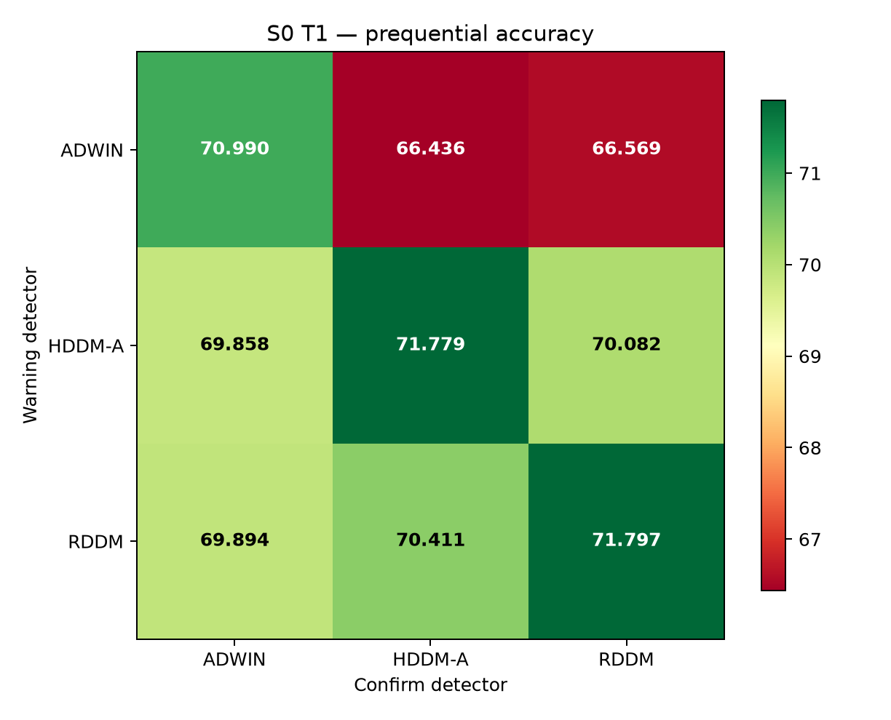

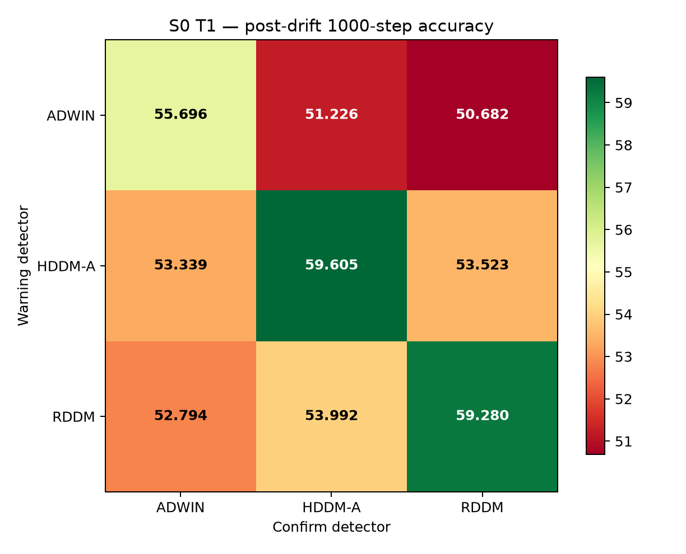

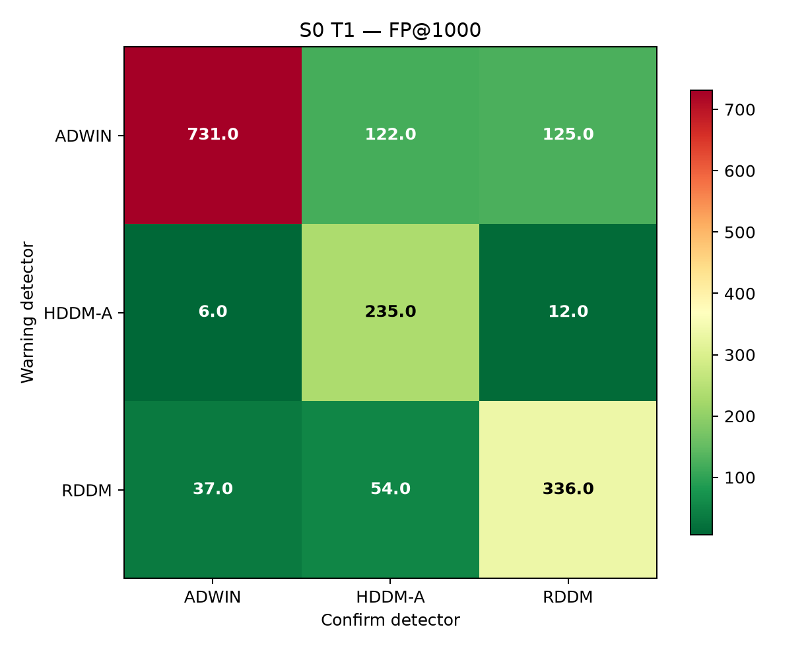

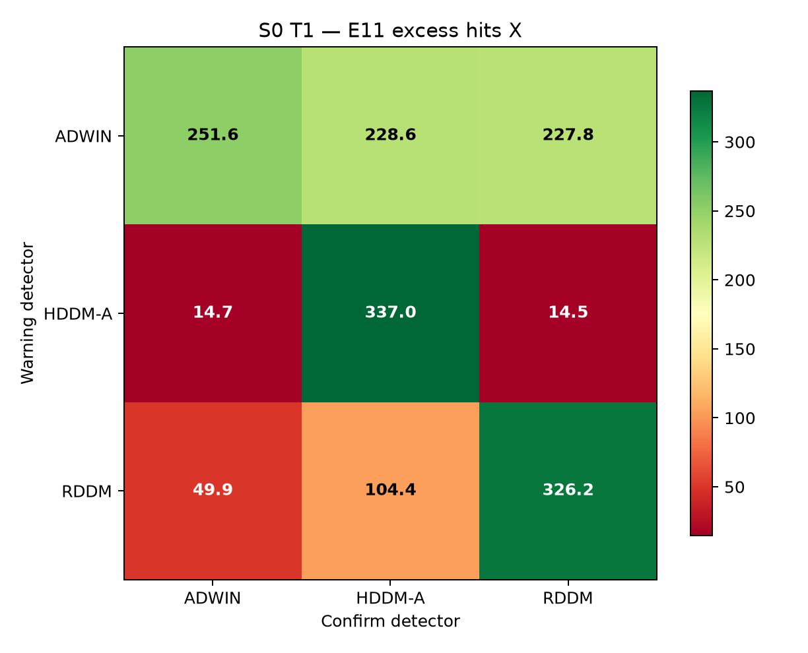

| warning | confirm | preq. accuracy | drift 後 accuracy | FP@1000 | X | 凍結步數 |
|---|---|---|---|---|---|---|
| ADWIN | ADWIN | 0.7099 | 0.5570 | 731 | 251.57 | 1,717,081 |
| ADWIN | HDDM-A | 0.6644 | 0.5123 | 122 | 228.63 | 7,029,077 |
| ADWIN | RDDM | 0.6657 | 0.5068 | 125 | 227.78 | 6,716,363 |
| HDDM-A | ADWIN | 0.6986 | 0.5334 | 6 | 14.66 | 40,222 |
| HDDM-A | HDDM-A | 0.7178 | 0.5961 | 235 | 336.97 | 32,212 |
| HDDM-A | RDDM | 0.7008 | 0.5352 | 12 | 14.46 | 21,360 |
| RDDM | ADWIN | 0.6989 | 0.5279 | 37 | 49.90 | 723,510 |
| RDDM | HDDM-A | 0.7041 | 0.5399 | 54 | 104.35 | 467,367 |
| RDDM | RDDM | 0.7180 | 0.5928 | 336 | 326.22 | 462,397 |

## S1 的 T1 3×3 矩陣顯示 detector 角色不可互換

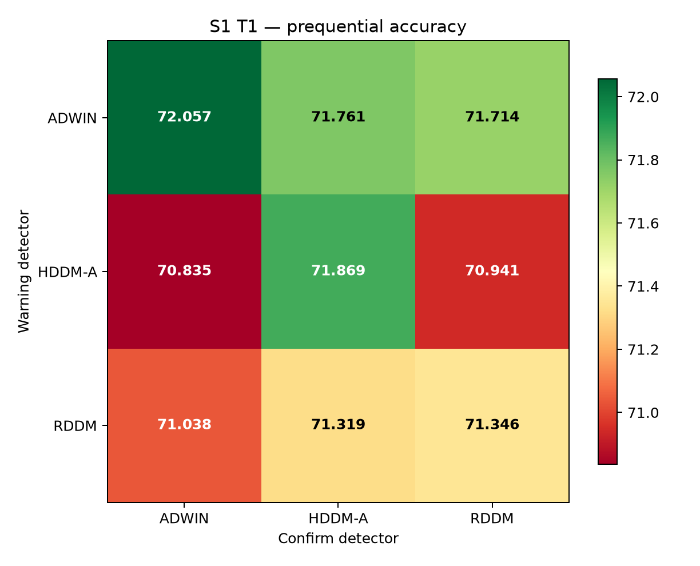

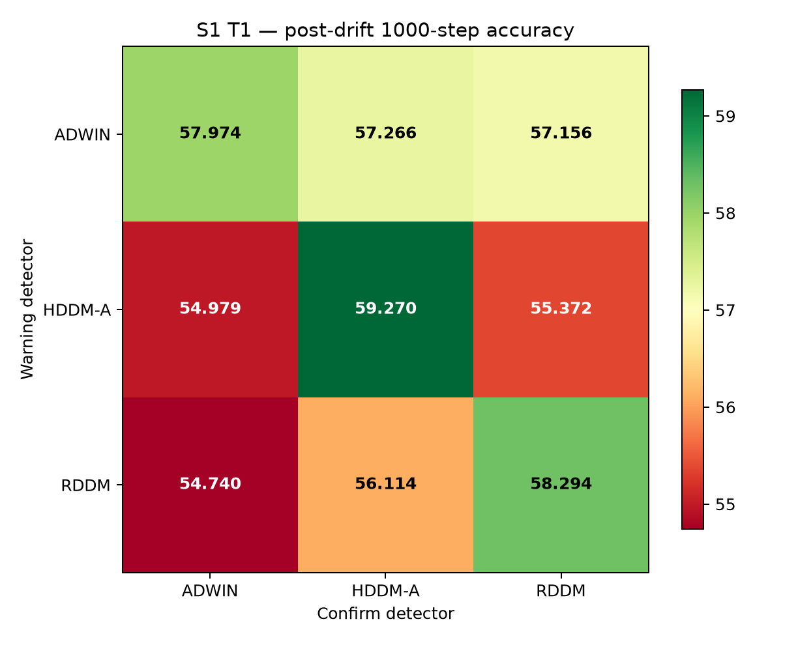

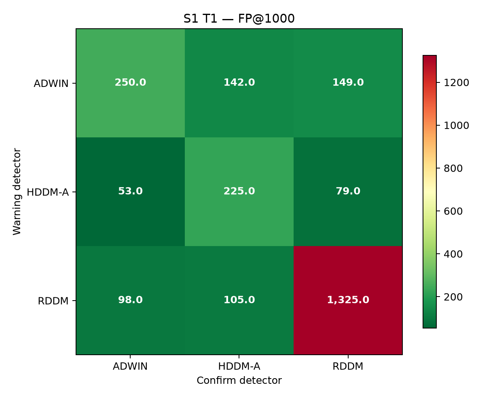

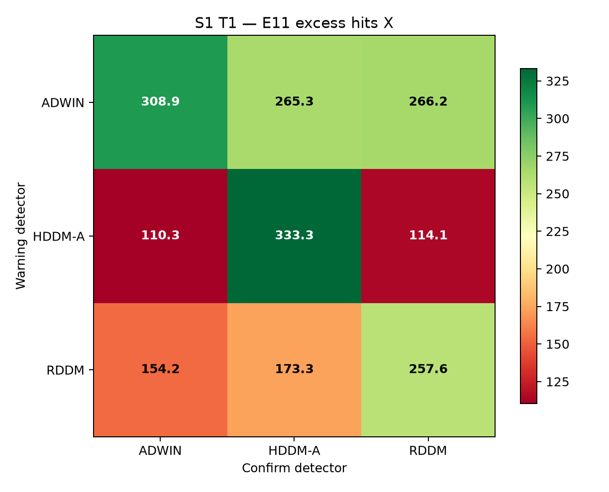

| warning | confirm | preq. accuracy | drift 後 accuracy | FP@1000 | X | 凍結步數 |
|---|---|---|---|---|---|---|
| ADWIN | ADWIN | 0.7206 | 0.5797 | 250 | 308.94 | 0 |
| ADWIN | HDDM-A | 0.7176 | 0.5727 | 142 | 265.30 | 0 |
| ADWIN | RDDM | 0.7171 | 0.5716 | 149 | 266.19 | 0 |
| HDDM-A | ADWIN | 0.7084 | 0.5498 | 53 | 110.26 | 0 |
| HDDM-A | HDDM-A | 0.7187 | 0.5927 | 225 | 333.27 | 0 |
| HDDM-A | RDDM | 0.7094 | 0.5537 | 79 | 114.09 | 0 |
| RDDM | ADWIN | 0.7104 | 0.5474 | 98 | 154.19 | 0 |
| RDDM | HDDM-A | 0.7132 | 0.5611 | 105 | 173.34 | 0 |
| RDDM | RDDM | 0.7135 | 0.5829 | 1,325 | 257.65 | 0 |

## 每格對 HDDM-A 對角的雙軸判定沒有產生可取代 H3 的事前候選

| 格（相對同框架 HDDM-A/HDDM-A） | ΔFP [CI] | ΔX [CI] | 偵測 | Δaccuracy pp [CI] | accuracy | Δpost-acc pp [CI] |
|---|---|---|---|---|---|---|
| S0 ADWIN/ADWIN | +496.0 [+444.0, +546.0] | -85.39 [-105.70, -66.83] | 不如 | -0.789 [-1.059, -0.511] | 不如 | -3.910 [-4.762, -3.106] |
| S0 ADWIN/HDDM-A | -113.0 [-150.0, -73.0] | -108.34 [-137.06, -81.94] | 持平 | -5.344 [-5.927, -4.771] | 不如 | -8.379 [-9.855, -6.991] |
| S0 ADWIN/RDDM | -110.0 [-145.0, -74.0] | -109.18 [-138.31, -81.29] | 持平 | -5.211 [-5.877, -4.571] | 不如 | -8.923 [-10.613, -7.277] |
| S0 HDDM-A/ADWIN | -229.0 [-271.0, -186.0] | -322.30 [-346.95, -297.68] | 持平 | -1.921 [-2.305, -1.531] | 不如 | -6.266 [-8.464, -4.197] |
| S0 HDDM-A/HDDM-A | +0.0 [+0.0, +0.0] | +0.00 [+0.00, +0.00] | 持平 | +0.000 [+0.000, +0.000] | 持平 | +0.000 [+0.000, +0.000] |
| S0 HDDM-A/RDDM | -223.0 [-263.0, -180.0] | -322.50 [-344.36, -300.61] | 持平 | -1.697 [-2.048, -1.336] | 不如 | -6.082 [-8.269, -4.003] |
| S0 RDDM/ADWIN | -198.0 [-240.0, -153.0] | -287.06 [-311.74, -262.53] | 持平 | -1.885 [-2.247, -1.526] | 不如 | -6.811 [-8.948, -4.752] |
| S0 RDDM/HDDM-A | -181.0 [-224.0, -137.0] | -232.61 [-258.17, -207.66] | 持平 | -1.369 [-1.693, -1.038] | 不如 | -5.613 [-7.637, -3.740] |
| S0 RDDM/RDDM | +101.0 [+55.0, +150.0] | -10.75 [-22.53, +0.85] | 持平 | +0.017 [-0.219, +0.262] | 持平 | -0.325 [-0.843, +0.171] |
| S1 ADWIN/ADWIN | +25.0 [-9.0, +59.0] | -24.33 [-40.10, -7.18] | 持平 | +0.187 [-0.044, +0.423] | 持平 | -1.296 [-2.004, -0.575] |
| S1 ADWIN/HDDM-A | -83.0 [-119.0, -49.0] | -67.97 [-91.42, -44.66] | 持平 | -0.108 [-0.342, +0.131] | 持平 | -2.004 [-2.941, -1.087] |
| S1 ADWIN/RDDM | -76.0 [-114.0, -40.0] | -67.08 [-88.15, -45.75] | 持平 | -0.155 [-0.365, +0.059] | 持平 | -2.114 [-3.001, -1.269] |
| S1 HDDM-A/ADWIN | -172.0 [-209.0, -137.0] | -223.01 [-250.54, -195.26] | 持平 | -1.034 [-1.347, -0.718] | 不如 | -4.291 [-5.906, -2.731] |
| S1 HDDM-A/HDDM-A | +0.0 [+0.0, +0.0] | +0.00 [+0.00, +0.00] | 持平 | +0.000 [+0.000, +0.000] | 持平 | +0.000 [+0.000, +0.000] |
| S1 HDDM-A/RDDM | -146.0 [-180.0, -115.0] | -219.18 [-246.70, -191.85] | 持平 | -0.929 [-1.232, -0.619] | 不如 | -3.898 [-5.574, -2.232] |
| S1 RDDM/ADWIN | -127.0 [-161.0, -95.0] | -179.08 [-205.74, -151.99] | 持平 | -0.831 [-1.112, -0.548] | 不如 | -4.530 [-6.207, -2.924] |
| S1 RDDM/HDDM-A | -120.0 [-155.0, -87.0] | -159.93 [-187.21, -133.05] | 持平 | -0.550 [-0.842, -0.252] | 不如 | -3.156 [-4.684, -1.757] |
| S1 RDDM/RDDM | +1,100.0 [+970.0, +1,234.0] | -75.63 [-94.52, -55.92] | 不如 | -0.523 [-0.753, -0.301] | 不如 | -0.976 [-1.482, -0.485] |

H3 以外的格即使 T1 較好，也依預註冊只屬事後觀察，不改列候選。

## Warning 列效果與 confirm 欄效果呈現交互作用，不能用單一 detector 排名取代

| 框架 | 固定條件 | 配對差 | ΔFP [CI] | ΔX [CI] | 偵測 | Δaccuracy pp [CI] | accuracy |
|---|---|---|---|---|---|---|---|
| S0 | 固定 confirm=ADWIN | ADWIN − HDDM-A | +725.0 [+675.0, +775.0] | +236.91 [+213.76, +259.32] | 持平 | +1.132 [+0.678, +1.577] | 優於 |
| S0 | 固定 confirm=ADWIN | ADWIN − RDDM | +694.0 [+645.0, +743.0] | +201.67 [+177.05, +225.82] | 持平 | +1.096 [+0.676, +1.527] | 優於 |
| S0 | 固定 confirm=ADWIN | HDDM-A − RDDM | -31.0 [-42.0, -21.0] | -35.24 [-49.21, -21.20] | 持平 | -0.036 [-0.292, +0.212] | 持平 |
| S0 | 固定 confirm=HDDM-A | ADWIN − HDDM-A | -113.0 [-150.0, -73.0] | -108.34 [-137.06, -81.94] | 持平 | -5.344 [-5.927, -4.771] | 不如 |
| S0 | 固定 confirm=HDDM-A | ADWIN − RDDM | +68.0 [+46.0, +91.0] | +124.28 [+91.56, +156.77] | 持平 | -3.975 [-4.534, -3.432] | 不如 |
| S0 | 固定 confirm=HDDM-A | HDDM-A − RDDM | +181.0 [+137.0, +224.0] | +232.61 [+207.66, +258.17] | 持平 | +1.369 [+1.038, +1.693] | 優於 |
| S0 | 固定 confirm=RDDM | ADWIN − HDDM-A | +113.0 [+91.0, +135.0] | +213.32 [+182.82, +242.88] | 持平 | -3.513 [-4.108, -2.934] | 不如 |
| S0 | 固定 confirm=RDDM | ADWIN − RDDM | -211.0 [-260.0, -165.0] | -98.43 [-125.34, -72.61] | 持平 | -5.228 [-5.914, -4.568] | 不如 |
| S0 | 固定 confirm=RDDM | HDDM-A − RDDM | -324.0 [-379.0, -270.0] | -311.75 [-332.50, -290.39] | 持平 | -1.715 [-2.093, -1.329] | 不如 |
| S1 | 固定 confirm=ADWIN | ADWIN − HDDM-A | +197.0 [+168.0, +226.0] | +198.67 [+171.09, +225.94] | 持平 | +1.222 [+0.939, +1.517] | 優於 |
| S1 | 固定 confirm=ADWIN | ADWIN − RDDM | +152.0 [+125.0, +179.0] | +154.75 [+128.31, +180.57] | 持平 | +1.018 [+0.732, +1.312] | 優於 |
| S1 | 固定 confirm=ADWIN | HDDM-A − RDDM | -45.0 [-63.0, -28.0] | -43.93 [-73.25, -16.23] | 持平 | -0.203 [-0.427, +0.018] | 持平 |
| S1 | 固定 confirm=HDDM-A | ADWIN − HDDM-A | -83.0 [-119.0, -49.0] | -67.97 [-91.42, -44.66] | 持平 | -0.108 [-0.342, +0.131] | 持平 |
| S1 | 固定 confirm=HDDM-A | ADWIN − RDDM | +37.0 [+11.0, +64.0] | +91.96 [+62.28, +120.82] | 持平 | +0.442 [+0.158, +0.741] | 優於 |
| S1 | 固定 confirm=HDDM-A | HDDM-A − RDDM | +120.0 [+87.0, +155.0] | +159.93 [+133.05, +187.21] | 持平 | +0.550 [+0.252, +0.842] | 優於 |
| S1 | 固定 confirm=RDDM | ADWIN − HDDM-A | +70.0 [+43.0, +99.0] | +152.10 [+127.78, +177.10] | 持平 | +0.774 [+0.505, +1.058] | 優於 |
| S1 | 固定 confirm=RDDM | ADWIN − RDDM | -1,176.0 [-1,314.0, -1,042.0] | +8.54 [-11.45, +27.68] | 持平 | +0.368 [+0.107, +0.633] | 優於 |
| S1 | 固定 confirm=RDDM | HDDM-A − RDDM | -1,246.0 [-1,382.0, -1,114.0] | -143.56 [-171.17, -116.46] | 持平 | -0.406 [-0.762, -0.037] | 不如 |

| 框架 | 固定條件 | 配對差 | ΔFP [CI] | ΔX [CI] | 偵測 | Δaccuracy pp [CI] | accuracy |
|---|---|---|---|---|---|---|---|
| S0 | 固定 warning=ADWIN | ADWIN − HDDM-A | +609.0 [+564.0, +653.0] | +22.94 [-6.39, +53.58] | 持平 | +4.555 [+3.962, +5.166] | 優於 |
| S0 | 固定 warning=ADWIN | ADWIN − RDDM | +606.0 [+558.0, +652.0] | +23.79 [-7.28, +56.54] | 持平 | +4.422 [+3.717, +5.140] | 優於 |
| S0 | 固定 warning=ADWIN | HDDM-A − RDDM | -3.0 [-24.0, +18.0] | +0.85 [-18.38, +20.55] | 持平 | -0.133 [-0.631, +0.367] | 持平 |
| S0 | 固定 warning=HDDM-A | ADWIN − HDDM-A | -229.0 [-271.0, -186.0] | -322.30 [-346.95, -297.68] | 持平 | -1.921 [-2.305, -1.531] | 不如 |
| S0 | 固定 warning=HDDM-A | ADWIN − RDDM | -6.0 [-14.0, +2.0] | +0.20 [-8.67, +9.49] | 持平 | -0.224 [-0.414, -0.042] | 不如 |
| S0 | 固定 warning=HDDM-A | HDDM-A − RDDM | +223.0 [+180.0, +263.0] | +322.50 [+300.61, +344.36] | 持平 | +1.697 [+1.336, +2.048] | 優於 |
| S0 | 固定 warning=RDDM | ADWIN − HDDM-A | -17.0 [-35.0, +1.0] | -54.45 [-85.29, -25.90] | 持平 | -0.516 [-0.853, -0.190] | 不如 |
| S0 | 固定 warning=RDDM | ADWIN − RDDM | -299.0 [-355.0, -246.0] | -276.31 [-299.44, -252.99] | 持平 | -1.903 [-2.283, -1.512] | 不如 |
| S0 | 固定 warning=RDDM | HDDM-A − RDDM | -282.0 [-336.0, -230.0] | -221.86 [-248.00, -195.20] | 持平 | -1.386 [-1.755, -1.014] | 不如 |
| S1 | 固定 warning=ADWIN | ADWIN − HDDM-A | +108.0 [+76.0, +139.0] | +43.64 [+25.26, +64.19] | 持平 | +0.295 [+0.084, +0.512] | 優於 |
| S1 | 固定 warning=ADWIN | ADWIN − RDDM | +101.0 [+73.0, +129.0] | +42.75 [+24.66, +62.35] | 持平 | +0.342 [+0.165, +0.524] | 優於 |
| S1 | 固定 warning=ADWIN | HDDM-A − RDDM | -7.0 [-25.0, +12.0] | -0.89 [-17.54, +15.70] | 持平 | +0.047 [-0.119, +0.218] | 持平 |
| S1 | 固定 warning=HDDM-A | ADWIN − HDDM-A | -172.0 [-209.0, -137.0] | -223.01 [-250.54, -195.26] | 持平 | -1.034 [-1.347, -0.718] | 不如 |
| S1 | 固定 warning=HDDM-A | ADWIN − RDDM | -26.0 [-45.0, -8.0] | -3.83 [-21.28, +13.48] | 持平 | -0.105 [-0.318, +0.098] | 持平 |
| S1 | 固定 warning=HDDM-A | HDDM-A − RDDM | +146.0 [+115.0, +180.0] | +219.18 [+191.85, +246.70] | 持平 | +0.929 [+0.619, +1.232] | 優於 |
| S1 | 固定 warning=RDDM | ADWIN − HDDM-A | -7.0 [-30.0, +15.0] | -19.15 [-50.34, +13.12] | 持平 | -0.281 [-0.538, -0.027] | 不如 |
| S1 | 固定 warning=RDDM | ADWIN − RDDM | -1,227.0 [-1,363.0, -1,095.0] | -103.46 [-132.17, -74.51] | 持平 | -0.308 [-0.636, +0.024] | 持平 |
| S1 | 固定 warning=RDDM | HDDM-A − RDDM | -1,220.0 [-1,359.0, -1,084.0] | -84.30 [-114.56, -54.28] | 持平 | -0.027 [-0.365, +0.318] | 持平 |

## Q4 顯示跨資料集不穩健，最差情況否定全域替換

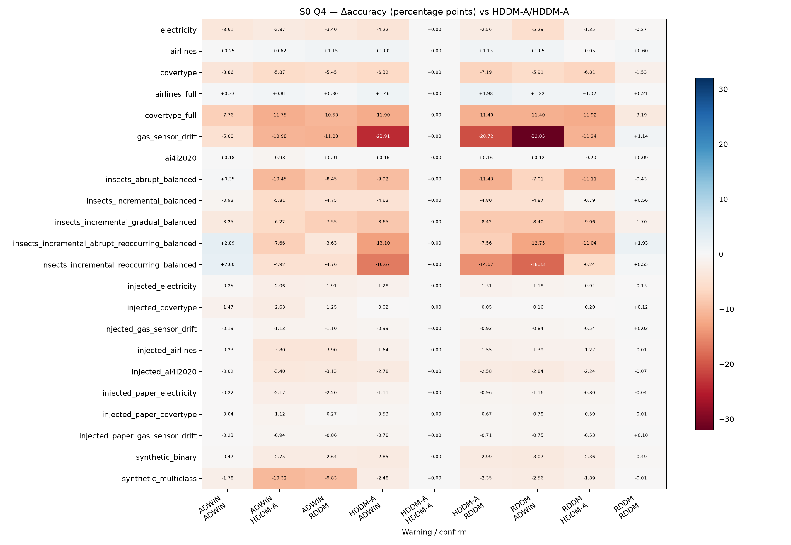

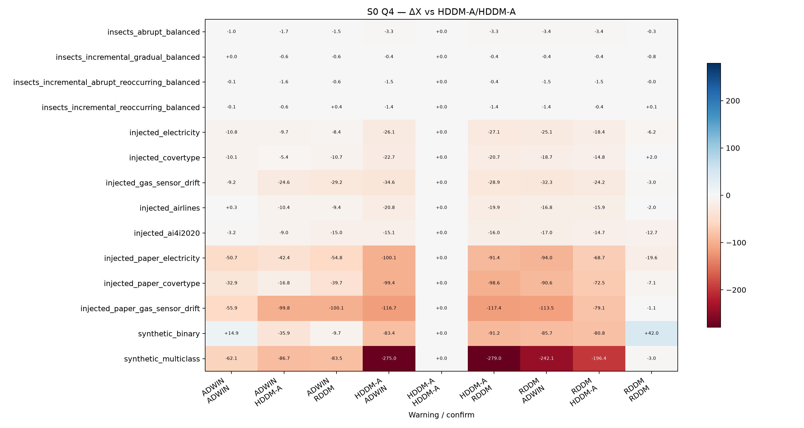

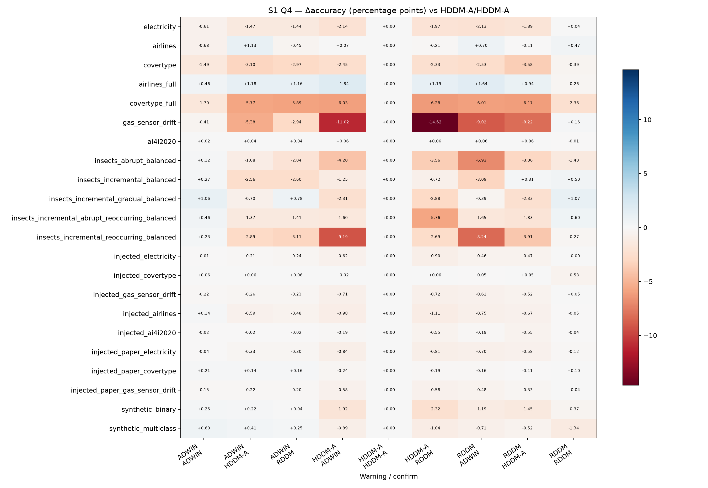

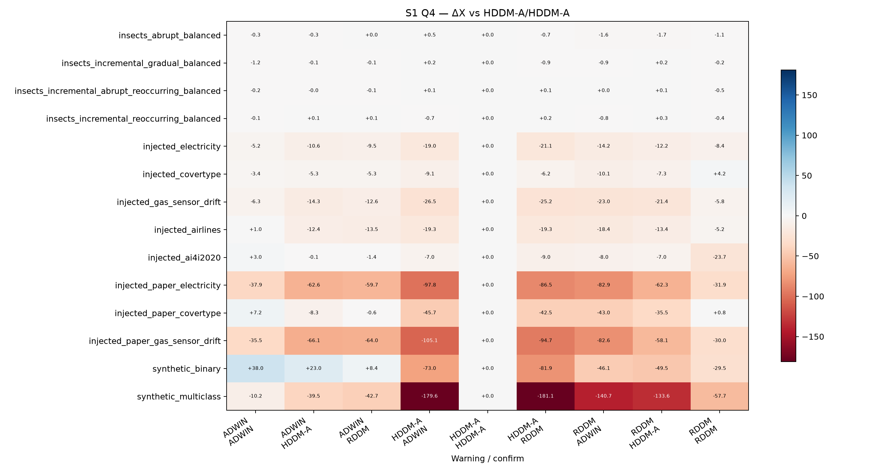

| 格 | Δaccuracy 中位數 pp | 最差資料集 (pp) | CI 全負資料集 | ΔX 中位數 | 最差資料集 (ΔX) | X CI 全負資料集 |
|---|---|---|---|---|---|---|
| S0 ADWIN/ADWIN | -0.227 | covertype_full (-7.761) | 8 | -6.19 | synthetic_multiclass (-62.06) | 8 |
| S0 ADWIN/HDDM-A | -3.134 | covertype_full (-11.751) | 10 | -10.04 | injected_paper_gas_sensor_drift (-99.76) | 10 |
| S0 ADWIN/RDDM | -3.267 | gas_sensor_drift (-11.028) | 10 | -10.19 | injected_paper_gas_sensor_drift (-100.14) | 9 |
| S0 HDDM-A/ADWIN | -2.627 | gas_sensor_drift (-23.911) | 9 | -24.39 | synthetic_multiclass (-274.99) | 10 |
| S0 HDDM-A/HDDM-A | +0.000 | electricity (+0.000) | 0 | +0.00 | insects_abrupt_balanced (+0.00) | 0 |
| S0 HDDM-A/RDDM | -2.456 | gas_sensor_drift (-20.719) | 9 | -23.92 | synthetic_multiclass (-279.04) | 10 |
| S0 RDDM/ADWIN | -2.699 | gas_sensor_drift (-32.049) | 9 | -21.91 | synthetic_multiclass (-242.14) | 10 |
| S0 RDDM/HDDM-A | -1.309 | covertype_full (-11.924) | 9 | -17.17 | synthetic_multiclass (-196.38) | 10 |
| S0 RDDM/RDDM | -0.009 | covertype_full (-3.189) | 2 | -1.54 | injected_paper_electricity (-19.61) | 3 |
| S1 ADWIN/ADWIN | +0.038 | covertype_full (-1.698) | 2 | -0.73 | injected_paper_electricity (-37.94) | 2 |
| S1 ADWIN/HDDM-A | -0.298 | covertype_full (-5.772) | 6 | -6.80 | injected_paper_gas_sensor_drift (-66.12) | 6 |
| S1 ADWIN/RDDM | -0.266 | covertype_full (-5.890) | 6 | -3.37 | injected_paper_gas_sensor_drift (-64.00) | 6 |
| S1 HDDM-A/ADWIN | -0.936 | gas_sensor_drift (-11.021) | 8 | -19.14 | synthetic_multiclass (-179.62) | 10 |
| S1 HDDM-A/HDDM-A | +0.000 | electricity (+0.000) | 0 | +0.00 | insects_abrupt_balanced (+0.00) | 0 |
| S1 HDDM-A/RDDM | -0.969 | gas_sensor_drift (-14.623) | 9 | -20.22 | synthetic_multiclass (-181.14) | 10 |
| S1 RDDM/ADWIN | -0.707 | gas_sensor_drift (-9.022) | 8 | -16.28 | synthetic_multiclass (-140.73) | 10 |
| S1 RDDM/HDDM-A | -0.563 | gas_sensor_drift (-8.217) | 8 | -12.80 | synthetic_multiclass (-133.63) | 10 |
| S1 RDDM/RDDM | -0.023 | covertype_full (-2.363) | 5 | -5.54 | synthetic_multiclass (-57.66) | 6 |

Accuracy 涵蓋 22 個非迴歸 registry 資料集；X 只涵蓋 14 個有非空 GT 的資料集。單串流資料集只報點估計，不計入『CI 全負』。各資料集先在自身尺度配對，不用總樣本數加權掩蓋最差情況。

## 資料類別與 drift 型態分層顯示效果來源異質

| 格 | 真實 Δacc/X | INSECTS Δacc/X | 注入 CSV Δacc/X | 注入 paper Δacc/X | 合成 Δacc/X |
|---|---|---|---|---|---|
| S0 ADWIN/ADWIN | -3.61 / — | +0.35 / -0.1 | -0.23 / -9.2 | -0.22 / -50.7 | -1.12 / -23.6 |
| S0 ADWIN/HDDM-A | -2.87 / — | -6.22 / -1.1 | -2.63 / -9.7 | -1.12 / -42.4 | -6.54 / -61.3 |
| S0 ADWIN/RDDM | -3.40 / — | -4.76 / -0.6 | -1.91 / -10.7 | -0.86 / -54.8 | -6.23 / -46.6 |
| S0 HDDM-A/ADWIN | -4.22 / — | -9.92 / -1.4 | -1.28 / -22.7 | -0.78 / -100.1 | -2.66 / -179.2 |
| S0 HDDM-A/HDDM-A | +0.00 / — | +0.00 / +0.0 | +0.00 / +0.0 | +0.00 / +0.0 | +0.00 / +0.0 |
| S0 HDDM-A/RDDM | -2.56 / — | -8.42 / -0.9 | -1.31 / -20.7 | -0.71 / -98.6 | -2.67 / -185.1 |
| S0 RDDM/ADWIN | -5.29 / — | -8.40 / -1.4 | -1.18 / -18.7 | -0.78 / -94.0 | -2.81 / -163.9 |
| S0 RDDM/HDDM-A | -1.35 / — | -9.06 / -1.0 | -0.91 / -15.9 | -0.59 / -72.5 | -2.12 / -138.6 |
| S0 RDDM/RDDM | +0.09 / — | +0.55 / -0.1 | -0.01 / -3.0 | -0.01 / -7.1 | -0.25 / +19.5 |
| S1 ADWIN/ADWIN | -0.61 / — | +0.27 / -0.2 | -0.01 / -3.4 | -0.04 / -35.5 | +0.42 / +13.9 |
| S1 ADWIN/HDDM-A | -1.47 / — | -1.37 / -0.1 | -0.21 / -10.6 | -0.22 / -62.6 | +0.32 / -8.2 |
| S1 ADWIN/RDDM | -1.44 / — | -2.04 / -0.0 | -0.23 / -9.5 | -0.20 / -59.7 | +0.15 / -17.2 |
| S1 HDDM-A/ADWIN | -2.14 / — | -2.31 / +0.1 | -0.62 / -19.0 | -0.58 / -97.8 | -1.40 / -126.3 |
| S1 HDDM-A/HDDM-A | +0.00 / — | +0.00 / +0.0 | +0.00 / +0.0 | +0.00 / +0.0 | +0.00 / +0.0 |
| S1 HDDM-A/RDDM | -1.97 / — | -2.88 / -0.3 | -0.72 / -19.3 | -0.58 / -86.5 | -1.68 / -131.5 |
| S1 RDDM/ADWIN | -2.13 / — | -3.09 / -0.8 | -0.46 / -14.2 | -0.48 / -82.6 | -0.95 / -93.4 |
| S1 RDDM/HDDM-A | -1.89 / — | -2.33 / +0.1 | -0.52 / -12.2 | -0.33 / -58.1 | -0.98 / -91.6 |
| S1 RDDM/RDDM | -0.01 / — | +0.50 / -0.4 | -0.04 / -5.8 | +0.04 / -30.0 | -0.86 / -43.6 |

| 格 | 突變 Δacc/X | 漸變 Δacc/X | incremental Δacc/X | recurring Δacc/X |
|---|---|---|---|---|
| S0 ADWIN/ADWIN | -0.42 [-0.91, +0.03] / -22.3 [-32.0, -13.1] | -0.91 [-1.31, -0.51] / -32.7 [-46.3, -20.3] | -1.46 [-2.45, -0.39] / -30.4 [-44.9, -17.0] | -0.25 [-1.89, +1.23] / -10.9 [-20.9, -4.0] |
| S0 ADWIN/HDDM-A | -5.57 [-6.95, -4.18] / -45.6 [-70.1, -24.8] | -3.97 [-5.05, -2.87] / -32.7 [-52.8, -16.0] | -9.42 [-11.27, -7.61] / -32.3 [-49.9, -18.0] | -8.66 [-10.47, -6.77] / -47.2 [-64.4, -30.8] |
| S0 ADWIN/RDDM | -5.44 [-6.78, -4.05] / -43.4 [-66.3, -24.2] | -4.09 [-5.27, -2.93] / -38.5 [-61.4, -18.8] | -8.25 [-10.55, -5.98] / -28.5 [-45.3, -13.6] | -7.13 [-8.70, -5.51] / -47.8 [-64.2, -30.2] |
| S0 HDDM-A/ADWIN | -2.11 [-2.79, -1.48] / -132.4 [-181.9, -88.0] | -1.49 [-1.95, -1.04] / -105.0 [-153.4, -61.0] | -3.48 [-6.22, -1.10] / -86.8 [-108.9, -63.3] | -2.38 [-5.75, +0.16] / -67.6 [-83.3, -50.7] |
| S0 HDDM-A/HDDM-A | +0.00 [+0.00, +0.00] / +0.0 [+0.0, +0.0] | +0.00 [+0.00, +0.00] / +0.0 [+0.0, +0.0] | +0.00 [+0.00, +0.00] / +0.0 [+0.0, +0.0] | +0.00 [+0.00, +0.00] / +0.0 [+0.0, +0.0] |
| S0 HDDM-A/RDDM | -2.00 [-2.56, -1.43] / -130.4 [-180.5, -85.5] | -1.07 [-1.52, -0.61] / -104.1 [-152.2, -60.5] | -3.30 [-5.49, -1.44] / -88.9 [-110.4, -65.0] | -1.84 [-4.58, +0.30] / -68.8 [-85.1, -50.2] |
| S0 RDDM/ADWIN | -2.17 [-2.80, -1.56] / -121.7 [-166.7, -81.5] | -1.22 [-1.63, -0.81] / -88.1 [-130.5, -50.5] | -3.93 [-6.55, -1.82] / -79.2 [-99.0, -58.6] | -3.41 [-6.74, -0.87] / -61.8 [-77.0, -45.4] |
| S0 RDDM/HDDM-A | -1.65 [-2.32, -1.01] / -116.8 [-163.8, -75.2] | -1.27 [-1.68, -0.85] / -71.3 [-105.1, -41.0] | -1.44 [-3.19, +0.01] / -46.4 [-57.0, -34.8] | -2.33 [-4.50, -0.39] / -56.2 [-70.9, -40.9] |
| S0 RDDM/RDDM | -0.05 [-0.52, +0.45] / -3.9 [-9.9, +2.0] | -0.02 [-0.23, +0.23] / -3.1 [-11.3, +5.1] | +0.46 [+0.02, +0.88] / -4.6 [-10.8, +1.1] | +0.67 [-0.97, +2.39] / -2.4 [-5.3, +0.3] |
| S1 ADWIN/ADWIN | -0.08 [-0.37, +0.20] / -4.7 [-11.2, +1.5] | +0.15 [-0.13, +0.45] / -11.7 [-24.9, +2.4] | +1.24 [+0.23, +2.32] / -9.3 [-14.8, -4.2] | +1.34 [-0.08, +2.67] / +2.9 [-4.6, +13.1] |
| S1 ADWIN/HDDM-A | -0.39 [-0.70, -0.09] / -31.2 [-45.5, -19.4] | -0.06 [-0.39, +0.31] / -13.9 [-27.8, +0.2] | +0.57 [-0.38, +1.48] / -23.0 [-36.1, -11.0] | +0.83 [-0.61, +2.23] / -8.8 [-27.1, +8.1] |
| S1 ADWIN/RDDM | -0.46 [-0.73, -0.19] / -30.5 [-43.2, -19.5] | -0.13 [-0.39, +0.14] / -18.2 [-34.4, -2.3] | +0.72 [-0.27, +1.76] / -18.6 [-27.1, -9.9] | +0.74 [-0.69, +2.19] / -9.7 [-23.0, +5.0] |
| S1 HDDM-A/ADWIN | -1.43 [-1.85, -1.03] / -92.8 [-125.5, -63.7] | -0.72 [-1.10, -0.34] / -70.1 [-105.8, -38.5] | -0.86 [-2.43, +0.63] / -59.9 [-77.8, -40.6] | -0.92 [-2.78, +0.73] / -39.8 [-58.0, -22.4] |
| S1 HDDM-A/HDDM-A | +0.00 [+0.00, +0.00] / +0.0 [+0.0, +0.0] | +0.00 [+0.00, +0.00] / +0.0 [+0.0, +0.0] | +0.00 [+0.00, +0.00] / +0.0 [+0.0, +0.0] | +0.00 [+0.00, +0.00] / +0.0 [+0.0, +0.0] |
| S1 HDDM-A/RDDM | -1.51 [-1.97, -1.07] / -87.9 [-119.3, -60.5] | -0.57 [-0.95, -0.21] / -72.7 [-110.0, -39.8] | -0.49 [-1.90, +0.89] / -59.3 [-78.5, -39.5] | -1.11 [-2.89, +0.67] / -40.2 [-59.5, -21.7] |
| S1 RDDM/ADWIN | -1.33 [-1.77, -0.91] / -78.3 [-108.4, -51.1] | -0.52 [-0.84, -0.20] / -54.9 [-83.2, -30.7] | -0.27 [-1.70, +0.96] / -46.7 [-61.2, -31.0] | -1.03 [-2.67, +0.43] / -27.1 [-42.9, -12.4] |
| S1 RDDM/HDDM-A | -1.11 [-1.51, -0.72] / -75.2 [-106.4, -47.6] | -0.20 [-0.51, +0.10] / -46.9 [-73.5, -23.9] | +0.03 [-1.25, +1.37] / -37.5 [-54.1, -21.4] | -0.35 [-2.02, +1.34] / -34.6 [-53.9, -16.1] |
| S1 RDDM/RDDM | -0.52 [-0.91, -0.16] / -31.1 [-43.2, -19.5] | -0.50 [-0.88, -0.16] / -21.5 [-38.9, -4.8] | -0.52 [-1.18, +0.16] / -23.8 [-32.3, -15.5] | -1.67 [-3.18, -0.31] / -7.8 [-16.3, +3.5] |

類別表採各資料集相對差的中位數；型態表用 T1 同型態串流的配對 bootstrap。複合型態可出現在多欄，分層只描述異質性，不改主要判定。

## Warning 生命週期與成本證據可重現且需分開解讀

| 格 | warning 開啟 | 確認 | 自行關閉 | 自行關閉 % | timeout | reference switch | 截尾 | 平均確認延遲 | 凍結步數 |
|---|---|---|---|---|---|---|---|---|---|
| S0 ADWIN/ADWIN | 8,708 | 8,335 | 0 | 0.0 | 0 | 0 | 373 | 1,368.1 | 22,068,902 |
| S0 ADWIN/HDDM-A | 4,007 | 2,849 | 0 | 0.0 | 0 | 0 | 1,158 | 9,885.7 | 58,835,862 |
| S0 ADWIN/RDDM | 4,247 | 3,200 | 0 | 0.0 | 0 | 0 | 1,047 | 11,261.1 | 53,896,696 |
| S0 HDDM-A/ADWIN | 39,428 | 341 | 39,074 | 99.1 | 0 | 0 | 13 | 336.4 | 973,176 |
| S0 HDDM-A/HDDM-A | 37,402 | 9,504 | 27,879 | 74.5 | 0 | 0 | 19 | 37.8 | 785,993 |
| S0 HDDM-A/RDDM | 29,340 | 1,029 | 28,309 | 96.5 | 0 | 0 | 2 | 17.2 | 240,722 |
| S0 RDDM/ADWIN | 236,337 | 586 | 235,625 | 99.7 | 0 | 0 | 126 | 133.0 | 7,166,922 |
| S0 RDDM/HDDM-A | 148,364 | 2,134 | 146,154 | 98.5 | 0 | 0 | 76 | 56.8 | 4,774,686 |
| S0 RDDM/RDDM | 126,359 | 11,139 | 115,147 | 91.1 | 0 | 0 | 73 | 218.9 | 4,782,304 |
| S1 ADWIN/ADWIN | 9,113 | 7,603 | 0 | 0.0 | 1,443 | 32 | 35 | 65.4 | 0 |
| S1 ADWIN/HDDM-A | 7,266 | 4,969 | 0 | 0.0 | 2,147 | 85 | 65 | 106.5 | 0 |
| S1 ADWIN/RDDM | 7,261 | 5,219 | 0 | 0.0 | 1,899 | 78 | 65 | 115.8 | 0 |
| S1 HDDM-A/ADWIN | 32,895 | 2,597 | 30,168 | 91.7 | 108 | 11 | 11 | 9.4 | 0 |
| S1 HDDM-A/HDDM-A | 33,629 | 11,146 | 22,336 | 66.4 | 114 | 20 | 13 | 17.5 | 0 |
| S1 HDDM-A/RDDM | 30,052 | 2,972 | 27,060 | 90.0 | 11 | 9 | 0 | 5.3 | 0 |
| S1 RDDM/ADWIN | 221,316 | 2,894 | 216,469 | 97.8 | 1,659 | 147 | 147 | 32.8 | 0 |
| S1 RDDM/HDDM-A | 220,130 | 3,459 | 214,688 | 97.5 | 1,656 | 229 | 98 | 32.8 | 0 |
| S1 RDDM/RDDM | 271,517 | 19,029 | 249,225 | 91.8 | 1,709 | 1,433 | 121 | 99.4 | 0 |

逐 run 驗證 `開啟 = close + censored`。平均確認延遲用 confirmed warning buffer 長度；S1 凍結步數固定為 0。

| 格（electricity, workers=1） | runtime s | CPU s | instances/s | RSS 增量 MB | final model MB | RAM-hours GB |
|---|---|---|---|---|---|---|
| S0 ADWIN/ADWIN | 14.89 | 14.08 | 3,043.1 | 2.7 | 13.75 | 0.000000 |
| S0 ADWIN/HDDM-A | 17.88 | 16.54 | 2,534.3 | 3.4 | 11.61 | 0.000001 |
| S0 ADWIN/RDDM | 14.08 | 13.66 | 3,218.3 | 7.2 | 9.42 | 0.000002 |
| S0 HDDM-A/ADWIN | 11.20 | 11.02 | 4,044.3 | 0.0 | 10.64 | 0.000000 |
| S0 HDDM-A/HDDM-A | 18.19 | 17.43 | 2,491.3 | 5.3 | 6.85 | 0.000001 |
| S0 HDDM-A/RDDM | 13.40 | 12.90 | 3,381.7 | 8.4 | 7.96 | 0.000006 |
| S0 RDDM/ADWIN | 10.46 | 10.08 | 4,333.0 | 3.8 | 8.89 | 0.000001 |
| S0 RDDM/HDDM-A | 13.15 | 12.74 | 3,446.1 | 6.8 | 9.05 | 0.000006 |
| S0 RDDM/RDDM | 17.84 | 16.40 | 2,540.3 | 0.0 | 9.28 | 0.000000 |
| S1 ADWIN/ADWIN | 20.06 | 19.47 | 2,258.5 | 6.3 | 10.69 | 0.000002 |
| S1 ADWIN/HDDM-A | 22.49 | 20.97 | 2,014.7 | 0.0 | 12.55 | 0.000000 |
| S1 ADWIN/RDDM | 23.41 | 21.45 | 1,935.6 | 6.6 | 12.46 | 0.000001 |
| S1 HDDM-A/ADWIN | 17.17 | 16.13 | 2,638.3 | 3.5 | 8.28 | 0.000001 |
| S1 HDDM-A/HDDM-A | 31.79 | 30.42 | 1,425.5 | 4.2 | 15.17 | 0.000001 |
| S1 HDDM-A/RDDM | 18.01 | 17.27 | 2,516.1 | 2.3 | 7.98 | 0.000000 |
| S1 RDDM/ADWIN | 14.73 | 14.17 | 3,076.4 | 0.0 | 8.35 | 0.000000 |
| S1 RDDM/HDDM-A | 18.02 | 16.68 | 2,515.3 | 0.0 | 8.71 | 0.000000 |
| S1 RDDM/RDDM | 20.14 | 19.37 | 2,250.0 | 4.5 | 10.39 | 0.000001 |

Strict timing 的 18/18 runs 均為 Apple M4、`concurrent_runs=1`，可直接比較時間；完整批次多數 `concurrent_runs=6`，時間只作參考，記憶體仍是逐程序量測。五個沿用對角共 1,025 個舊 run 沒有新版 cost block，未補算；其餘成本見[全範圍 cost.csv](compare_sota_all/cost.csv)。
[正式可比標準報表](compare_sota/report.md)只保留 registry 可比列；[全 22 資料集 exploratory 報表](compare_sota_all/report.md)明示不可據此宣稱 SOTA，並提供每資料集 × preset 的標準分類、偵測與成本欄位。DET4 全為 ECPF pipeline preset，`injected_paper_*` 只有 detector-only preset 可與 Cerqueira et al. 比較，因此本報告不作文獻 SOTA 聲明。

## 30,456 個邏輯 runs 全數通過完整性稽核

正式矩陣共 30,456 個邏輯 runs：新跑 29,431、沿用對角 1,025；22 個資料集 × 18 組配置的規劃數全部到齊。T1、T3、short、paper、full 五批皆 failed=0、errors=[]、skipped=[]；正式批次牆上時間合計 100.77 小時，另有 strict timing 5.98 分鐘。

稽核逐 run 驗證 preset、registry、來源 SHA-256、乾淨 commit、River 0.21.2、完整串流、GT、evaluator TP/FP/FN、warning 事件守恆與 S1 零凍結；T1/T3 另從 preds 重算 drift 後 1000 步 accuracy。資料與 CI 見[機器可讀 verdict data](det4_verdict_data.json)，replay 與 smoke 見[stage2 gate](stage2_gate.md)及[stage3 smoke](stage3_smoke.md)。大型逐 run artifacts 保持 git-ignored。

## 事後觀察不改寫預註冊結論

- S0 T1 accuracy 點估計最高為 S0 RDDM/RDDM（0.7180）；X 最高為 S0 HDDM-A/HDDM-A（336.97）。兩者只作事後描述，沒有 T3 事前候選資格。
- S1 T1 accuracy 點估計最高為 S1 ADWIN/ADWIN（0.7206）；X 最高為 S1 HDDM-A/HDDM-A（333.27）。兩者只作事後描述，沒有 T3 事前候選資格。

## 偏離、失敗與缺漏不改變主要判定

- Registry 在 smoke 前確認實際為 25 個資料集、排除 3 個迴歸後為 22 個；不是原附件文字的 23 個。此修訂已在正式執行前追加至預註冊，未補造資料，30,456 總量不變。
- Full 批次第一次執行在 Airlines 完成後，位於 `/private/tmp` 的暫存 Python runtime 被系統清理，Covertype 因缺少標準庫／pandas 中止。已保留 18/18 Airlines checkpoint，改用專案內 `.venv311` 從 Covertype 恢復；最終 full summary 為 36/36、回傳碼 0、零失敗。這是執行環境偏離，不改資料、preset、metric 或判準。
- 沿用的 1,025 個 DET1/DET3 對角 runs 沒有新版 cost block；判定指標完整，成本缺值不補算。另行 strict timing 18/18 完整，提供統一環境的時間與記憶體比較。

## 限制把結論鎖定在本研究的 ECPF pipeline

本輪只測單棵 Hoeffding Tree；ADWIN 與 HDDM-A 來自 River 0.21.2，RDDM 採已驗證的 MOA replay 實作。Synthetic、部分 INSECTS 與 injected 資料曾用於前輪開發；T3 只對 H3 指定格提供未用於 DET 的保留驗證。迴歸未測；混搭 warning/confirm 的 reset、zone exit 與 timeout 語意是本研究定義。沒有 GT 的真實資料只支持預測與成本描述；pipeline 偵測指標不可與 detector-only 文獻 SOTA 並列。CI 描述本批配對串流的條件不確定性，不是跨任務母體保證。
